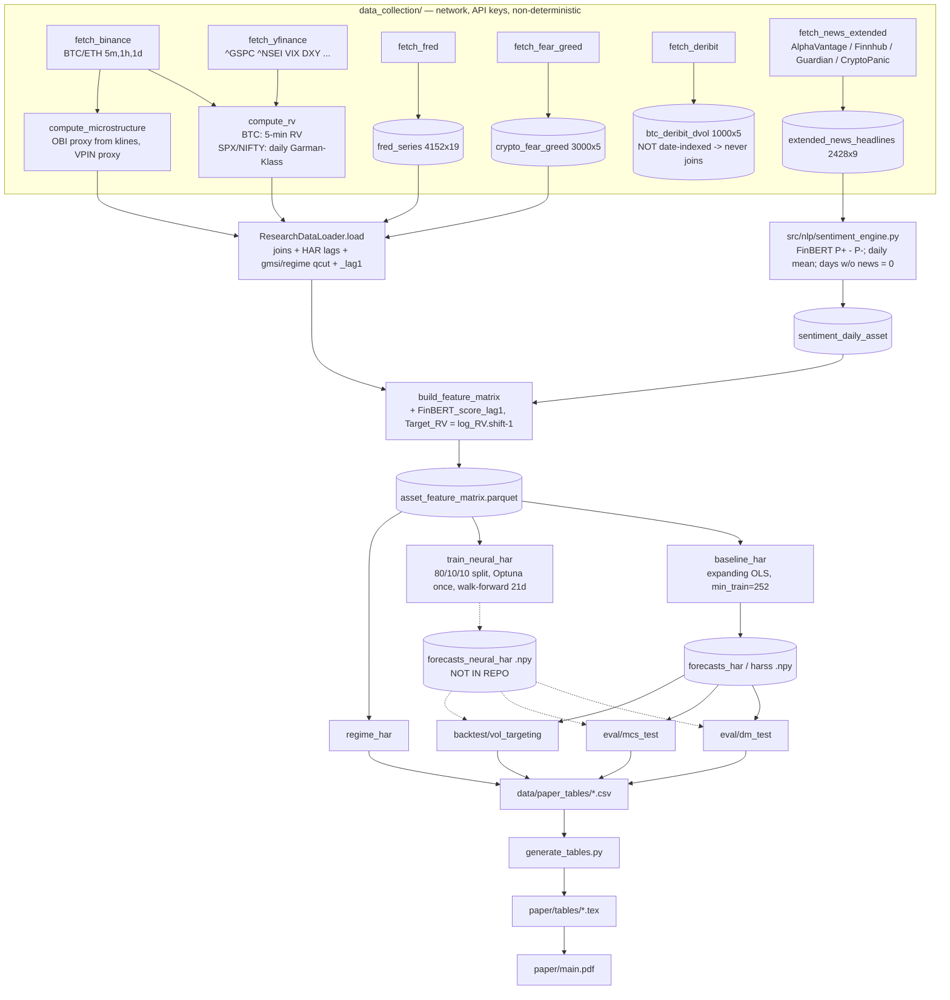

# 00 — Repository Map (Phase 1, read-only reconnaissance)

**Project:** *Forecasting Realized Volatility in Markets: Does Sentiment Add Information Beyond the HAR Framework?*
**Domain:** Realized-volatility (RV) forecasting. The paper compares HAR, HAR-S (sentiment-augmented HAR) and Neural-HAR (an OLS HAR prior plus a GRN/FT-Transformer residual ensemble) on BTC, SPX and NIFTY 50.
**Target venue (from `paper/main.tex`):** Journal of Empirical Finance (`elsarticle`, 3p).
**Audit environment:** Python 3.11.17 in an isolated `.venv` built with `uv`. CPU only (4 cores, no GPU). torch 2.14.1 from PyPI. The full freeze is in `analysis/artifacts/env_freeze.txt`.

Every number in this file was produced by one of these scripts. They were run in this session and are deterministic and read-only with respect to project sources:

| Script | Output |
|---|---|
| `scripts/audit_trace_pipeline.py` | `analysis/artifacts/phase1_trace.json` (shapes, lag alignment, sentiment coverage) |
| `scripts/audit_rebuild_check.py` | `analysis/artifacts/phase1_rebuild_check.json` (rebuild-from-raw + tensor shapes) |
| `scripts/audit_qlike_bias_check.py` | `analysis/artifacts/phase1_qlike_bias_check.json` (HAR bias-correction test) |

---

## 1. Directory inventory

| Path | Role | Reachable from an entry point? | Notes |
|---|---|---|---|
| `run_paper.py` | **Master runner** (steps build/har/neural/dm/mcs/regime/backtest + table export) | Entry point | Writes `paper_run.log` in the repo root, opened with `mode="w"`. |
| `data_collection/fetch_all.py` + `sources/*`, `utils/*` | Raw data acquisition (Binance, yfinance, FRED, Deribit, news APIs, Fear&Greed) and RV/microstructure computation | Entry point (run from `data_collection/` as CWD; uses `from utils...` imports) | Needs network and API keys. Not re-runnable deterministically: the vendors revise data. |
| `src/data_pipeline/data_loader.py` | Joins RV, microstructure, FRED, F&G, VIX/DVOL; computes HAR lags, `gmsi`, `regime` | via `build_feature_matrix` | |
| `src/data_pipeline/build_feature_matrix.py` | Adds sentiment and target, then writes `data/processed/{asset}_feature_matrix.parquet` | `run_paper.py --step build` / CLI | |
| `src/nlp/sentiment_engine.py` | FinBERT (`ProsusAI/finbert`) scoring → `sentiment_daily_{asset}.parquet` | **Standalone CLI only.** Not called by `run_paper.py`. | Default input path `data/raw/sentiment/...` does not exist from the repo root; the real file is under `data_collection/data/raw/...`. |
| `src/models/baseline_har.py` | HAR / HAR-S expanding-window OLS | `run_paper.py` | |
| `src/models/neural_har.py` | `NeuralHAR`, `DeepGRN`, `TabularTransformer`, `qlike_loss` | via `train_neural_har.py` | `train_model`, `EarlyStopping` and the `__main__` mock block are **dead code** (mock data only). |
| `src/models/train_neural_har.py` | Optuna HPO + walk-forward training + inverse-loss ensemble | `run_paper.py --step neural` / CLI | **No seeds set anywhere.** |
| `src/models/regime_har.py` | Regime-conditional HAR | `run_paper.py --step regime` | |
| `eval/dm_test.py`, `eval/mcs_test.py` | Diebold–Mariano (HLN) and Model Confidence Set | `run_paper.py` | |
| `backtest/vol_targeting.py` | Vol-targeting backtest | `run_paper.py --step backtest` | `load_and_run()` is dead and points at a non-existent `binance_btc_1d.parquet`. |
| `backtest/tc_optimizer.py` | `apply_slippage(): pass` | **Dead stub** | |
| `src/data_pipeline/ws_ingestion.py`, `processor.cpp`, `src/cpp_inference/*` | "Low-latency C++/TensorRT engine" | **Dead stubs** (empty `main`, `predict_rv(){return 0.0;}`) | `project_brief.md` claims "< 10 ms p99 on Jetson". No such code exists. |
| `notebooks/paper_tables.py` | Second table/figure generator (Tables 1–7, Figs 1–4) | Standalone | Duplicates `run_paper.export_paper_tables`. Loads `forecasts_hars_*.npy`, but `baseline_har.py` saves `forecasts_harss_*.npy` (`'har-s'.replace('-','s')`), so HAR-S is silently missing. |
| `generate_tables.py` | CSV → `paper/tables/*.tex` | Standalone | |
| `check_latex.py` | Static LaTeX ref/cite check | Standalone | |
| `paper/` | Manuscript (`main.tex`, 10 sections, 10 tables, `main.pdf`) | — | |
| `data/processed/` | Feature matrices, HAR/HAR-S forecasts, sentiment | — | **No Neural-HAR forecasts or weights** (`forecasts_neural_har_*.npy` and `data/models/` are absent). |
| `data/paper_tables`, `data/paper_figures` | Canonical result CSV/PNG | — | |
| `data/{deep_grn,transformer,ensemble}_results/` | Results of 3 different Neural-HAR variants | — | Evidence that several architectures were tried and compared **on the test window**. See §7. |
| `*.zip` (6 archives, ~1 MB each) | Snapshots of results and the paper | — | Redundant binaries in VCS. |

Line counts (`wc -l`, tracked files): total 6,188 across `.py/.cpp/.tex/.md`. The largest modules are `notebooks/paper_tables.py` (509), `run_paper.py` (527), `fetch_news_extended.py` (481), `train_neural_har.py` (361) and `mcs_test.py` (331).

## 2. Pipeline (as implemented, not as documented)

## 3. Stage map: ingestion → preprocessing → model → train → eval → inference

| Stage | File:function | What it does |
|---|---|---|
| Ingestion | `data_collection/sources/*.run` | Downloads to `data_collection/data/raw/**.parquet` |
| RV construction | `compute_rv.py:compute_crypto_rv` (BTC), `:compute_tradfi_rv` (SPX/NIFTY) | BTC: Σ r² over 5-min returns per UTC day. SPX/NIFTY: **daily Garman–Klass from one OHLC bar**. This is not intraday RV, but `03_data.tex` lists the indices under "high-frequency". |
| Preprocessing | `data_loader.py:ResearchDataLoader.load` | Joins, HAR lags, `*_lag1`, `gmsi`, `regime` |
| Feature matrix | `build_feature_matrix.py:build_feature_matrix` | Adds sentiment, `Target_RV`, drops NaN core rows |
| Model def | `neural_har.py:NeuralHAR` | `har_linear(X_har) + residual_head(network(X_exo))` |
| Training | `train_neural_har.py:train_asset` | HPO on train/val, pretrain 50 epochs on train+val, walk-forward fine-tuning (5 epochs every 21 rows) |
| Evaluation | `run_paper.py:step_dm/step_mcs/step_backtest`, `eval/*` | End-aligned trailing window of the shortest forecast array |
| Inference | — | No inference path exists. The C++ "engine" is a stub. |

## 4. One example traced end-to-end (BTC; shapes measured)

| Hop | Object | Shape (rows × cols) | Source |
|---|---|---|---|
| 1 | `raw/ohlcv/btc_5min.parquet` | 795,988 × 11 | parquet metadata (`phase1_trace.json`) |
| 2 | `raw/realized_vol/btc_rv_daily.parquet` | 2,767 × 12 (2019-01-01 → 2026-07-29) | trace |
| 2b | `raw/microstructure/btc_obi_daily` / `btc_vpin_daily` | 2,767 × 8 / 2,767 × 1 | trace |
| 2c | `raw/macro/fred_series` / `crypto_fear_greed` | 4,152 × 19 / 3,000 × 5 | trace |
| 3 | `ResearchDataLoader.load('btc')` | 2,745 × 50 | `phase1_rebuild_check.json` |
| 4 | `btc_feature_matrix.parquet` | 2,744 × 16 (2019-01-23 → 2026-07-28) | trace |
| 5a | HAR design matrix (const + 3 lags) | 2,744 × 4; **2,492** OOS forecasts (rows 252…2743) | rebuild check |
| 5b | HAR-S design (const + 3 + 8 exo) | 2,744 × 12, but only **1,095** rows have all exo non-null (credit spread starts 2023-05-17), giving **1,119** HAR-S OOS forecasts | rebuild check / trace |
| 6 | Neural-HAR tensors | `X_har` 2,744 × 3, `X_exo` 2,744 × 8, `y` 2,744 × 1 | rebuild check |
| 6b | Neural-HAR split | train 2,195 / val 274 / **test 275**, test starts 2025-10-27 | rebuild check |
| 7 | DM/MCS inputs | all arrays trimmed to the trailing **275** | `run_paper.py:167-173` |

SPX: matrix 2,862 × 13, HAR-S complete rows 755, Neural test 287 from 2025-06-05. NIFTY: 2,755 × 13, 719, test 276 from 2025-06-16.

**Rebuild check.** Re-running `build_feature_matrix` on the committed raw data reproduces all three committed matrices exactly (same index, max |Δ| = 0.0 on every numeric column). The one exception is the **NIFTY `regime` labels, which differ** between the rebuild and the committed file. Cause not yet known; to be investigated in Phase 2.

## 5. Findings from the trace (data-verified, carried into Phases 2–4)

1. **HAR is mis-specified as a 2-step-ahead model.** In every matrix, `RV_d == log_RV.shift(1)` (max |Δ| = 0.0 for BTC) and `Target_RV == log_RV.shift(-1)`. The regression therefore predicts log RV(t+1) from log RV(t−1, …) and **never uses log RV(t)**, the most informative lag. For BTC, corr(Target, log_RV_t) = 0.703 vs corr(Target, RV_d) = 0.549. All exogenous `_lag1` features skip day t in the same way. `04_methodology.tex` writes the 1-step equation. *(`data_loader.py:323-325`, `compute_rv.py:38-40`, `build_feature_matrix.py:124-130`)*
2. **For SPX/NIFTY, `RV_d` is not even a clean 1-day lag after row drops.** max |RV_d − log_RV.shift(1)| = 0.0027 (SPX) and 3.10 (NIFTY). The lags were computed on the raw calendar before rows with zero GK variance were dropped. The SPX/NIFTY calendars also contain 35–39-day gaps (trace `calendar_gaps_days_value_counts`).
3. **The SPX/NIFTY RV proxy has almost no persistence.** corr(log_RV_{t+1}, log_RV_t) = 0.118 (SPX) and 0.073 (NIFTY), vs 0.703 for BTC's 5-min RV. A single-bar Garman–Klass proxy is extremely noisy. Phase 2 will profile it.
4. **Sentiment is essentially absent.** `FinBERT_score_lag1` is exactly 0 on 98.5 % of BTC rows, 92.3 % of SPX and 92.3 % of NIFTY. BTC has FinBERT scores on **43 days only (2026-06-18 → 2026-07-30), all inside the Neural-HAR test window**, so the model never sees non-zero BTC sentiment in training. Of 2,428 headlines, 2,310 are from 2025–2026 (`phase1_trace.json → news`).
5. **`illiq_lag1` is identically 0 for all assets.** It is a placeholder (`data_loader.py:445-447`) because `illiq` is never lagged (`exo_cols` at `:439` omits it). It still enters HAR-S/Neural-HAR, and `table2_insample_coefs` reports a p-value (0.095) for an all-zero regressor.
6. **`credit_spread_lag1` only exists from 2023-05-17.** It is NaN on 1,644/2,744 BTC rows and 2,107/2,862 SPX rows. HAR-S drops those rows in training, while Neural-HAR fills them with **0** (`train_neural_har.py:232`). The network therefore receives a feature that is 0 before mid-2023 and about 3–4 afterwards, which works as a time-period indicator.
7. **Regimes are not regimes.** `gmsi` exists only where credit spread exists. `pd.qcut` then splits only the post-2023 data, and `.ffill().bfill()` labels **every pre-2023 day "high"** (BTC "high" = 1,933 rows from 2019-01-23; "medium" starts 2024-01-26; "low" starts 2024-11-08). The terciles also use the full sample (look-ahead), and the paper says the regimes come from a Hidden Markov Model, which does not exist in the code.
8. **DVOL never joins.** `btc_deribit_dvol.parquet` has a RangeIndex (0…999) rather than dates, so `dvol` never appears in the matrix.

### 5.1 Headline-threatening check (reported to the user immediately)

`scripts/audit_qlike_bias_check.py`: HAR is fit by OLS in log space, so `exp(f)` estimates the conditional *median* of RV, while QLIKE is minimized by the conditional *mean*. Neural-HAR is trained directly on QLIKE and so learns that level shift. A causal smearing correction (Duan 1983; uses only residuals realized before the forecast date; zero tuned parameters) applied to the committed HAR forecasts gives:

| Asset (window N) | HAR QLIKE, reproduced | = paper `table3_mcs` | HAR + smearing | Neural-HAR (paper) |
|---|---|---|---|---|
| BTC (275) | 0.31840 | 0.31840 | 0.30811 | 0.28659 |
| SPX (287) | 3.89658 | 3.89658 | **1.45520** | 1.56691 |
| NIFTY (276) | 2.33046 | 2.33046 | **1.22398** | 1.86984 |

On the paper's own evaluation windows, bias-corrected HAR has lower mean QLIKE than Neural-HAR for SPX and NIFTY. The "sole MCS survivor for SPX" and the QLIKE DM wins are therefore not evidence that sentiment or non-linearity adds information. The DM/MCS re-test against Neural-HAR is **NOT COMPUTED**, because the Neural-HAR forecasts are not in the repository and must be regenerated (Phase 5).

## 6. Dependencies

**Declared:** `requirements.txt` (root, all lower bounds `>=`, nothing pinned) and `data_collection/requirements.txt` (unversioned).

| Library | Declared | Used in code | Status |
|---|---|---|---|
| numpy, pandas, scipy, statsmodels, scikit-learn, pyarrow, matplotlib | root (`>=`) | yes | Unpinned. Results depend on resolver date. |
| torch | root `>=2.0` | yes | Unpinned. Under the Optuna/torch defaults used, results are nondeterministic regardless. |
| **optuna** | **only `data_collection/requirements.txt`**; README says `pip install optuna` | `train_neural_har.py` | **Undeclared in the root requirements.** |
| transformers, tokenizers, tqdm | root | `sentiment_engine.py` | `sentencepiece` declared but unused by FinBERT. |
| **fredapi, pytrends, google-cloud-bigquery, python-dotenv, yfinance, requests** | root / data_collection | data_collection | `google-cloud-bigquery` is commented out in root but imported (`fetch_sentiment.py` imports `google`). pytrends is unmaintained (archived upstream). |
| torchvision, jupyter, seaborn, ccxt | root | **never imported** | Unnecessary. |

The audit env resolves to numpy 2.4.6, pandas 3.0.6, scipy 1.17.1, statsmodels 0.15.0, scikit-learn 1.9.1, optuna 5.0.0 and torch 2.14.1 (`env_freeze.txt`). The authors' versions are unknown: there is no lockfile, and `paper_run.log` records only Windows paths (`E:\AlphaVol-NeuralHAR-Global\...`).

Python version: not stated anywhere. `train_neural_har.py` uses `torch.load(..., weights_only=True)` in dead code only.

## 7. Reproducibility surface

| Item | Status | Evidence |
|---|---|---|
| Python `random` seed | Not set anywhere | grep |
| numpy seed in training | **Not set** in `train_neural_har.py` | file has no `seed` |
| torch seed | **Not set** in the live path. `torch.manual_seed(42)` exists only in dead `neural_har.train_model` (`neural_har.py:172`). | |
| Optuna sampler seed | **Not set** (`optuna.create_study(direction="minimize")`, `train_neural_har.py:136`) | |
| `torch.backends.cudnn.deterministic` / `use_deterministic_algorithms` | Not handled | |
| MCS bootstrap | Seeded (`seed=42`) | `mcs_test.py:448` |
| Data splits | Regenerated each run from chronological fractions (deterministic given data). Not saved. | `train_neural_har.py:236-238` |
| Raw data | Re-downloading is non-reproducible (vendor revisions, API windows such as AlphaVantage's "most recent ~1000 articles"). Committed raw parquet is the only stable source. | `fetch_news_extended.py:80-81` |
| Neural-HAR artefacts | **Forecasts and weights absent.** The paper appendix claims "the exact weights of the out-of-sample models evaluated in this study" are in the repo. | `ls data/processed`, `appendix.tex` |
| Multiple variants evaluated on the test set | `data/{deep_grn,transformer,ensemble}_results` hold 3 variants with very different test outcomes (SPX QLIKE DM: +0.23 / +5.04 / +5.05; BTC: −0.27 / +0.83 / +1.98). The best one is reported. | committed CSVs |

## 8. Version-control hygiene

* **Credentials committed:** `data_collection/.env.example` contains what appear to be **real NewsAPI and FRED API keys** (32-hex strings, not placeholders) and a local Windows path to a GCP service-account file. The keys should be rotated, and git history rewriting considered. The values are not reproduced here.
* **Gitignored but tracked:** `btc_5min.parquet` (56.9 MB), `eth_5min.parquet` (52.0 MB), `btc_1h.parquet` (6.1 MB), `manifest.json`. `.gitignore` lists them, but they were force-added, and two exceed GitHub's 50 MB warning threshold.
* **Should not be tracked:** 6 result/paper `.zip` snapshots, `paper_run.log`, `paper/main.pdf` (a build output), and 3 byte-identical copies of `fig1_rv_timeseries.png` (407,203 B each, same MD5).
* **Should be tracked but isn't:** Neural-HAR forecasts and weights (see above), a lockfile, a seed/config file, and the ETH pipeline output (computed but unused).
* **Absolute paths:** `notebooks/paper_tables.py:25` (`cd e:/AlphaVol-NeuralHAR-Global`), `.env.example` (`E:\...`), and `paper_run.log` (Windows paths throughout).
* **`*.json` is gitignored globally** (`.gitignore`, to protect GCP credentials). This will also hide any JSON results or artifacts unless excepted. **Relevant for `analysis/artifacts/*.json`:** I will need a `!analysis/artifacts/*.json` exception (hygiene fix, Phase 4).

## 9. Duplicated / near-duplicated code

* The QLIKE loss is implemented **6×**: `baseline_har.qlike_loss_numpy`, `regime_har.qlike_numpy`, `dm_test._loss_differential`, `run_paper.step_mcs` (inline), `train_neural_har.train_asset` (inline ×2), and the torch `neural_har.qlike_loss`. Clipping is inconsistent: ±15 in numpy versus `[-10,10]` on the prediction only in torch.
* The expanding-window OLS loop exists twice: `baseline_har.expanding_window_forecast` ≈ `regime_har.expanding_window_oos`.
* The exogenous-feature lists are hard-coded 4× with different contents. `regime_har` omits `crypto_fg_lag1`.
* The paper-table pipeline exists twice: `run_paper.export_paper_tables` vs `notebooks/paper_tables.py`. The latter had the front-alignment bug documented in `paper/CHANGELOG_vs_internal_notes.md`.
* The forecast end-alignment logic is copy-pasted in `step_dm`, `step_mcs` and `step_backtest`.

## 10. Documentation claims not supported by the code (pre-audit list)

| Claim (where) | Code reality |
|---|---|
| Regimes from a Hidden Markov Model (`01_introduction.tex`, `06_regime_analysis.tex`, `research_summary.md`) | Full-sample `pd.qcut` terciles of `credit_spread − term_slope`, back-filled (`data_loader.py:425-430`) |
| "Quarter-Kelly position sizing" (`07_economic_significance.tex`, README) | `kelly_fraction` is accepted but never used. `mu_hat=None`, so the strategy is pure `target_vol/σ̂` (`vol_targeting.py:54-59, 81`). |
| "Optuna … 40 trials at each step" (`04_methodology.tex`, README) | Optuna runs **once**, 20 trials per architecture, on the initial train/val split (`train_neural_har.py:267-276`) |
| "initial minimum training window of 252 days" for Neural-HAR (`04_methodology.tex`) | 80 %/10 % fractions, so the first training window is 2,195 (BTC) / 2,289 (SPX) / 2,204 (NIFTY) rows |
| Residual branch "takes both the HAR lags and the exogenous features" (`04_methodology.tex`, README) | The network sees **only** `X_exo` (`neural_har.py:113-117`) |
| "high-frequency" data for all three assets (abstract) | SPX/NIFTY use a daily-bar Garman–Klass proxy |
| C++/TensorRT engine, < 10 ms p99 on Jetson (`project_brief.md`) | Empty stubs |
| Code repo contains "exact weights of the OOS models" (`appendix.tex`) | Not present |
| VPIN, OBI from order book (`03_data.tex`) | OBI is a kline close-location proxy, VPIN a bulk-volume-classification proxy, both from 5-min bars. `btc_orderbook_snapshots` (40 rows) is unused. |
