# 01 — Data Profile (Phase 2)

*Generated by `scripts/profile_data.py` (seed 0, runtime 77.1 s). Every number below is read from `analysis/artifacts/data_profile.json`. Sampling: none (all rows used). Split rule: chronological 80%/10%/10% (train_neural_har.train_asset defaults).*

Sections 1–9 are generated automatically; section 10 (interpretation, provenance, and **what the data can and cannot support**) is maintained in `analysis/notes/01_data_profile_interpretation.md` and spliced in at the end.

## 1. Datasets, shape and splits (T1)

| Dataset | Rows | Cols | Start | End | Train/Val/Test | Test start | Disk (KB) | Memory (KB) |
|---|---|---|---|---|---|---|---|---|
| BTC feature matrix | 2744 | 16 | 2019-01-23 | 2026-07-28 | 2195/274/275 | 2025-10-27 | 224.4 | 335.1 |
| SPX feature matrix | 2862 | 13 | 2015-02-05 | 2026-07-28 | 2289/286/287 | 2025-06-05 | 179.6 | 282.4 |
| NIFTY feature matrix | 2755 | 13 | 2015-02-05 | 2026-07-28 | 2204/275/276 | 2025-06-16 | 173.5 | 271.9 |
| News headlines (FinBERT input) | 2428 | 12 | — | — | 86/62/2280 | — | 737.4 | 1753 |

### Raw source inventory

| file | disk_KB | rows | cols | memory_KB | null_pct_overall | index | start | end |
|---|---|---|---|---|---|---|---|---|
| data_collection/data/raw/macro/crypto_fear_greed.parquet | 54.5 | 3000 | 5 | 168.4 | 20.0 | RangeIndex (not date-indexed) |  |  |
| data_collection/data/raw/macro/fear_greed_index.parquet | 1.0 | 0 | 0 |  |  |  |  |  |
| data_collection/data/raw/macro/fred_series.parquet | 160.7 | 4152 | 20 | 648.8 | 7.8 |  | 2015-01-01 | 2026-05-14 |
| data_collection/data/raw/microstructure/btc_agg_trades.parquet | 32.5 | 1000 | 7 | 48.0 | 0.0 | RangeIndex (not date-indexed) |  |  |
| data_collection/data/raw/microstructure/btc_obi_daily.parquet | 227.3 | 2767 | 9 | 194.6 | 0.0 |  | 2019-01-01 | 2026-07-29 |
| data_collection/data/raw/microstructure/btc_orderbook_snapshots.parquet | 3.8 | 40 | 4 | 1.5 | 0.0 | RangeIndex (not date-indexed) |  |  |
| data_collection/data/raw/microstructure/btc_vpin_daily.parquet | 51.6 | 2767 | 2 | 43.2 | 0.1 |  | 2019-01-01 | 2026-07-29 |
| data_collection/data/raw/ohlcv/btc_1d.parquet | 251.7 | 2767 | 11 | 237.8 | 0.0 |  | 2019-01-01 | 2026-07-29 |
| data_collection/data/raw/ohlcv/btc_1h.parquet | 5971.7 | 66341 | 11 | 5701.2 | 0.0 |  | 2019-01-01 | 2026-07-29 |
| data_collection/data/raw/ohlcv/btc_5min.parquet | 55543.1 | 795988 | 11 | 68405.2 | 0.0 |  | 2019-01-01 | 2026-07-29 |
| data_collection/data/raw/ohlcv/dxy_1d.parquet | 103.8 | 2909 | 7 | 159.1 | 0.0 |  | 2015-01-02 | 2026-07-29 |
| data_collection/data/raw/ohlcv/eth_1d.parquet | 245.3 | 2767 | 11 | 237.8 | 0.0 |  | 2019-01-01 | 2026-07-29 |
| data_collection/data/raw/ohlcv/eth_5min.parquet | 50782.8 | 795990 | 11 | 68405.4 | 0.0 |  | 2019-01-01 | 2026-07-29 |
| data_collection/data/raw/ohlcv/gold_1d.parquet | 136.8 | 2908 | 7 | 159.0 | 0.0 |  | 2015-01-02 | 2026-07-29 |
| data_collection/data/raw/ohlcv/irx3m_1d.parquet | 91.7 | 2906 | 7 | 158.9 | 0.0 |  | 2015-01-02 | 2026-07-29 |
| data_collection/data/raw/ohlcv/nifty_1d.parquet | 149.0 | 2848 | 7 | 155.8 | 0.0 |  | 2015-01-02 | 2026-07-29 |
| data_collection/data/raw/ohlcv/spx_1d.parquet | 160.2 | 2909 | 7 | 159.1 | 0.0 |  | 2015-01-02 | 2026-07-29 |
| data_collection/data/raw/ohlcv/tnx10y_1d.parquet | 116.5 | 2906 | 7 | 158.9 | 0.0 |  | 2015-01-02 | 2026-07-29 |
| data_collection/data/raw/ohlcv/vix_1d.parquet | 107.0 | 2910 | 7 | 159.1 | 0.0 |  | 2015-01-02 | 2026-07-29 |
| data_collection/data/raw/ohlcv/vxn_1d.parquet | 109.8 | 2909 | 7 | 159.1 | 0.0 |  | 2015-01-02 | 2026-07-29 |
| data_collection/data/raw/options/btc_deribit_dvol.parquet | 32.1 | 1000 | 5 | 39.2 | 0.0 | RangeIndex (not date-indexed) |  |  |
| data_collection/data/raw/options/btc_deribit_options_chain.parquet | 20.2 | 844 | 5 | 48.8 | 0.0 | RangeIndex (not date-indexed) |  |  |
| data_collection/data/raw/options/spx_vix_term_structure.parquet | 98.6 | 3908 | 6 | 183.2 | 0.0 |  | 2011-01-03 | 2026-07-29 |
| data_collection/data/raw/realized_vol/btc_rv_daily.parquet | 334.6 | 2767 | 13 | 281.0 | 0.1 |  | 2019-01-01 | 2026-07-29 |
| data_collection/data/raw/realized_vol/eth_rv_daily.parquet | 334.8 | 2767 | 13 | 281.0 | 0.1 |  | 2019-01-01 | 2026-07-29 |
| data_collection/data/raw/realized_vol/nifty_rv_daily.parquet | 295.1 | 2848 | 11 | 244.8 | 0.4 |  | 2015-01-02 | 2026-07-29 |
| data_collection/data/raw/realized_vol/spx_rv_daily.parquet | 301.5 | 2909 | 11 | 250.0 | 0.2 |  | 2015-01-02 | 2026-07-29 |
| data_collection/data/raw/sentiment/extended_news_headlines.parquet | 737.4 | 2428 | 10 | 1496.1 | 11.1 | Index (not date-indexed) |  |  |
| data_collection/data/raw/sentiment/gdelt_daily.parquet | 1.0 | 0 | 0 |  |  |  |  |  |
| data_collection/data/raw/sentiment/google_trends_weekly.parquet | 1.0 | 0 | 0 |  |  |  |  |  |
| data_collection/data/raw/sentiment/newsapi_headlines.parquet | 58.8 | 198 | 7 | 96.7 | 0.6 | RangeIndex (not date-indexed) |  |  |

FRED series first valid date: `{'VIXCLS': '2015-01-02', 'VXNCLS': '2015-01-02', 'OVXCLS': '2015-01-02', 'GVZCLS': '2015-01-02', 'BAMLH0A0HYM2': '2023-05-16', 'BAMLC0A0CM': '2023-05-16', 'TEDRATE': '2015-01-02', 'T10Y2Y': '2015-01-02', 'T10Y3M': '2015-01-02', 'DPCREDIT': '2015-01-01', 'DCOILWTICO': '2015-01-02', 'DTWEXBGS': '2015-01-02', 'DFF': '2015-01-01', 'CPIAUCSL': '2015-01-01', 'UNRATE': '2015-01-01', 'USREC': '2015-01-01', 'M2SL': '2015-01-01', 'INDIRLTLT01STM': '2015-01-01', 'INDCPIALLMINMEI': '2015-01-01'}`; FRED pull ends **2026-05-14**.

## 2.1 BTC — column inventory

| column | dtype | semantic | non_null | null | null_pct | unique | cardinality_ratio | is_model_input |
|---|---|---|---|---|---|---|---|---|
| log_RV | float64 | continuous (same-day log variance; not a model input) | 2744 | 0 | 0 | 2744 | 1 | False |
| RV_d | float64 | continuous (HAR daily lag) | 2744 | 0 | 0 | 2744 | 1 | True |
| RV_w | float64 | continuous (HAR weekly lag) | 2744 | 0 | 0 | 2744 | 1 | True |
| RV_m | float64 | continuous (HAR monthly lag) | 2744 | 0 | 0 | 2744 | 1 | True |
| Target_RV | float64 | target (continuous, log variance t+1) | 2744 | 0 | 0 | 2744 | 1 | False |
| vpin_lag1 | float64 | continuous (bounded [0,1]) | 2744 | 0 | 0 | 2744 | 1 | True |
| obi_sq_lag1 | float64 | continuous (bounded [0,1]) | 2744 | 0 | 0 | 2744 | 1 | True |
| illiq_lag1 | float64 | continuous (placeholder) | 2744 | 0 | 0 | 1 | 0.000364 | True |
| roll_spread_lag1 | float64 | continuous (placeholder) | 2744 | 0 | 0 | 1 | 0.000364 | True |
| FinBERT_score_lag1 | float32 | continuous (bounded [-1,1], zero-inflated) | 2743 | 1 | 0.0364 | 41 | 0.0149 | True |
| sent_surprise_lag1 | float64 | continuous (zero-inflated) | 2742 | 2 | 0.0729 | 41 | 0.0149 | True |
| credit_spread_lag1 | float64 | continuous (percent) | 1100 | 1644 | 59.9 | 183 | 0.0667 | True |
| term_slope_lag1 | float64 | continuous (percent) | 2675 | 69 | 2.51 | 256 | 0.0933 | True |
| crypto_fg_lag1 | float64 | continuous/ordinal (bounded [0,1]) | 2670 | 74 | 2.7 | 90 | 0.0328 | True |
| gmsi | float64 | continuous (credit_spread - term_slope; not lagged) | 1100 | 1644 | 59.9 | 348 | 0.127 | False |
| regime | category | ordinal categorical (low<medium<high) | 2744 | 0 | 0 | 3 | 0.00109 | False |

## 2.2 SPX — column inventory

| column | dtype | semantic | non_null | null | null_pct | unique | cardinality_ratio | is_model_input |
|---|---|---|---|---|---|---|---|---|
| log_RV | float64 | continuous (same-day log variance; not a model input) | 2862 | 0 | 0 | 2862 | 1 | False |
| RV_d | float64 | continuous (HAR daily lag) | 2862 | 0 | 0 | 2862 | 1 | True |
| RV_w | float64 | continuous (HAR weekly lag) | 2862 | 0 | 0 | 2862 | 1 | True |
| RV_m | float64 | continuous (HAR monthly lag) | 2862 | 0 | 0 | 2862 | 1 | True |
| Target_RV | float64 | target (continuous, log variance t+1) | 2862 | 0 | 0 | 2862 | 1 | False |
| illiq_lag1 | float64 | continuous (placeholder) | 2862 | 0 | 0 | 1 | 0.000349 | True |
| roll_spread_lag1 | float64 | continuous (placeholder) | 2862 | 0 | 0 | 1 | 0.000349 | True |
| FinBERT_score_lag1 | float32 | continuous (bounded [-1,1], zero-inflated) | 2861 | 1 | 0.0349 | 218 | 0.0762 | True |
| sent_surprise_lag1 | float64 | continuous (zero-inflated) | 2860 | 2 | 0.0699 | 336 | 0.117 | True |
| credit_spread_lag1 | float64 | continuous (percent) | 755 | 2107 | 73.6 | 183 | 0.0639 | True |
| term_slope_lag1 | float64 | continuous (percent) | 2816 | 46 | 1.61 | 275 | 0.0961 | True |
| gmsi | float64 | continuous (credit_spread - term_slope; not lagged) | 755 | 2107 | 73.6 | 345 | 0.121 | False |
| regime | category | ordinal categorical (low<medium<high) | 2862 | 0 | 0 | 3 | 0.00105 | False |

## 2.3 NIFTY — column inventory

| column | dtype | semantic | non_null | null | null_pct | unique | cardinality_ratio | is_model_input |
|---|---|---|---|---|---|---|---|---|
| log_RV | float64 | continuous (same-day log variance; not a model input) | 2755 | 0 | 0 | 2755 | 1 | False |
| RV_d | float64 | continuous (HAR daily lag) | 2755 | 0 | 0 | 2755 | 1 | True |
| RV_w | float64 | continuous (HAR weekly lag) | 2755 | 0 | 0 | 2755 | 1 | True |
| RV_m | float64 | continuous (HAR monthly lag) | 2755 | 0 | 0 | 2755 | 1 | True |
| Target_RV | float64 | target (continuous, log variance t+1) | 2755 | 0 | 0 | 2755 | 1 | False |
| illiq_lag1 | float64 | continuous (placeholder) | 2755 | 0 | 0 | 1 | 0.000363 | True |
| roll_spread_lag1 | float64 | continuous (placeholder) | 2755 | 0 | 0 | 1 | 0.000363 | True |
| FinBERT_score_lag1 | float32 | continuous (bounded [-1,1], zero-inflated) | 2754 | 1 | 0.0363 | 211 | 0.0766 | True |
| sent_surprise_lag1 | float64 | continuous (zero-inflated) | 2753 | 2 | 0.0726 | 286 | 0.104 | True |
| credit_spread_lag1 | float64 | continuous (percent) | 719 | 2036 | 73.9 | 179 | 0.065 | True |
| term_slope_lag1 | float64 | continuous (percent) | 2708 | 47 | 1.71 | 273 | 0.0991 | True |
| gmsi | float64 | continuous (credit_spread - term_slope; not lagged) | 719 | 2036 | 73.9 | 333 | 0.121 | False |
| regime | category | ordinal categorical (low<medium<high) | 2755 | 0 | 0 | 3 | 0.00109 | False |

## 3. Univariate statistics — numeric (T2; per-split detail in JSON)

| Asset | Feature | N | Null% | Mean | Std | Min | P1 | Median | P99 | Max | Skew | ExKurt | Zero% | Out|z|>3% | Normality p |
|---|---|---|---|---|---|---|---|---|---|---|---|---|---|---|---|
| BTC | log_RV | 2744 | 0 | -7.397 | 1.07 | -11.7 | -9.938 | -7.407 | -4.691 | -2.202 | 0.1473 | 0.8261 | 0 | 0.656 | 4.879e-09 |
| BTC | RV_d | 2744 | 0 | -7.396 | 1.07 | -11.7 | -9.938 | -7.406 | -4.691 | -2.202 | 0.1464 | 0.8265 | 0 | 0.656 | 4.891e-09 |
| BTC | RV_w | 2744 | 0 | -7.395 | 0.8795 | -10.11 | -9.365 | -7.44 | -5.041 | -3.735 | 0.3472 | 0.4512 | 0 | 0.5466 | 6.324e-11 |
| BTC | RV_m | 2744 | 0 | -7.392 | 0.7487 | -9.419 | -8.943 | -7.423 | -5.375 | -5.151 | 0.3088 | 0.1539 | 0 | 0 | 1.874e-11 |
| BTC | Target_RV | 2744 | 0 | -7.397 | 1.07 | -11.7 | -9.938 | -7.407 | -4.691 | -2.202 | 0.1474 | 0.8252 | 0 | 0.656 | 5.03e-09 |
| BTC | vpin_lag1 | 2744 | 0 | 0.4785 | 0.0742 | 0.03465 | 0.2468 | 0.4845 | 0.6323 | 0.7144 | -1.136 | 4.057 | 0 | 1.166 | 3.415e-31 |
| BTC | obi_sq_lag1 | 2744 | 0 | 0.4283 | 0.0885 | 0.2584 | 0.2889 | 0.41 | 0.715 | 0.8885 | 1.098 | 1.642 | 0 | 1.239 | 4.825e-33 |
| BTC | illiq_lag1 | 2744 | 0 | 0 | 0 | 0 | 0 | 0 | 0 | 0 | — | — | 100 | — | — |
| BTC | roll_spread_lag1 | 2744 | 0 | 0 | 0 | 0 | 0 | 0 | 0 | 0 | — | — | 100 | — | — |
| BTC | FinBERT_score_lag1 | 2743 | 0.03644 | -0.0005195 | 0.0158 | -0.3082 | 0 | 0 | 0 | 0.2179 | -6.653 | 167.5 | 98.54 | 0.9479 | 1.427e-78 |
| BTC | sent_surprise_lag1 | 2742 | 0.07289 | -4.994e-05 | 0.01623 | -0.211 | 0 | 0 | 0 | 0.3018 | 1.04 | 144.2 | 98.54 | 1.204 | 2.879e-78 |
| BTC | credit_spread_lag1 | 1100 | 59.91 | 3.274 | 0.5028 | 2.59 | 2.61 | 3.15 | 4.58 | 4.79 | 0.9335 | -0.003563 | 0 | 0.09091 | 1.619e-25 |
| BTC | term_slope_lag1 | 2675 | 2.515 | 0.2345 | 0.5772 | -1.08 | -0.94 | 0.25 | 1.5 | 1.59 | 0.01383 | -0.4473 | 0.486 | 0 | 3.22e-18 |
| BTC | crypto_fg_lag1 | 2670 | 2.697 | 0.4805 | 0.2214 | 0.05 | 0.09 | 0.49 | 0.93 | 0.95 | 0.05258 | -1.042 | 0 | 0 | 9.739e-24 |
| BTC | gmsi | 1100 | 59.91 | 3.225 | 0.9032 | 1.99 | 2.04 | 2.94 | 5.28 | 5.45 | 0.656 | -0.7046 | 0 | 0 | 7.175e-25 |
| SPX | log_RV | 2862 | 0 | -11.05 | 2.592 | -27 | -19.08 | -10.63 | -6.569 | -4.117 | -1.082 | 2.308 | 0 | 1.258 | 3.252e-31 |
| SPX | RV_d | 2862 | 0 | -11.05 | 2.592 | -27 | -19.08 | -10.63 | -6.569 | -4.117 | -1.082 | 2.31 | 0 | 1.258 | 3.147e-31 |
| SPX | RV_w | 2862 | 0 | -11.05 | 1.45 | -15.73 | -14.34 | -11.08 | -7.538 | -5.024 | 0.1068 | 0.2169 | 0 | 0.559 | 0.0001329 |
| SPX | RV_m | 2862 | 0 | -11.05 | 1.06 | -13.72 | -13.06 | -11.16 | -8.153 | -6.453 | 0.6099 | 1.006 | 0 | 0.9085 | 2.929e-21 |
| SPX | Target_RV | 2862 | 0 | -11.05 | 2.592 | -27 | -19.08 | -10.63 | -6.569 | -4.117 | -1.082 | 2.308 | 0 | 1.258 | 3.252e-31 |
| SPX | illiq_lag1 | 2862 | 0 | 0 | 0 | 0 | 0 | 0 | 0 | 0 | — | — | 100 | — | — |
| SPX | roll_spread_lag1 | 2862 | 0 | 0 | 0 | 0 | 0 | 0 | 0 | 0 | — | — | 100 | — | — |
| SPX | FinBERT_score_lag1 | 2861 | 0.03494 | -0.002878 | 0.1236 | -0.95 | -0.6055 | 0 | 0.453 | 0.9238 | -1.674 | 34.37 | 92.38 | 3.041 | 3.038e-75 |
| SPX | sent_surprise_lag1 | 2860 | 0.06988 | -0.0001938 | 0.1344 | -1.256 | -0.5849 | 0 | 0.5063 | 1.021 | -0.8184 | 30.78 | 79.65 | 2.657 | 7.876e-72 |
| SPX | credit_spread_lag1 | 755 | 73.62 | 3.275 | 0.505 | 2.59 | 2.615 | 3.15 | 4.605 | 4.79 | 0.9494 | 0.02358 | 0 | 0 | 1.871e-21 |
| SPX | term_slope_lag1 | 2816 | 1.607 | 0.4716 | 0.6197 | -1.08 | -0.9085 | 0.51 | 1.66 | 1.77 | -0.2058 | -0.5432 | 0.2486 | 0 | 3.145e-18 |
| SPX | gmsi | 755 | 73.62 | 3.225 | 0.9036 | 1.99 | 2.051 | 2.94 | 5.28 | 5.45 | 0.6578 | -0.7072 | 0 | 0 | 1.034e-20 |
| NIFTY | log_RV | 2755 | 0 | -10.98 | 2.439 | -24.75 | -18.72 | -10.53 | -6.814 | -3.946 | -1.297 | 3.087 | 0 | 1.198 | 3.228e-35 |
| NIFTY | RV_d | 2755 | 0 | -10.98 | 2.438 | -24.75 | -18.72 | -10.53 | -6.814 | -3.946 | -1.298 | 3.095 | 0 | 1.234 | 3.175e-35 |
| NIFTY | RV_w | 2755 | 0 | -10.98 | 1.253 | -15.19 | -14.14 | -10.94 | -8.087 | -5.822 | -0.02734 | 0.5735 | 0 | 0.4719 | 9.697e-08 |
| NIFTY | RV_m | 2755 | 0 | -10.97 | 0.8223 | -12.87 | -12.46 | -11.05 | -8.373 | -7.058 | 0.8222 | 1.518 | 0 | 1.053 | 2.862e-25 |
| NIFTY | Target_RV | 2755 | 0 | -10.98 | 2.439 | -24.75 | -18.72 | -10.53 | -6.814 | -3.946 | -1.299 | 3.091 | 0 | 1.234 | 2.992e-35 |
| NIFTY | illiq_lag1 | 2755 | 0 | 0 | 0 | 0 | 0 | 0 | 0 | 0 | — | — | 100 | — | — |
| NIFTY | roll_spread_lag1 | 2755 | 0 | 0 | 0 | 0 | 0 | 0 | 0 | 0 | — | — | 100 | — | — |
| NIFTY | FinBERT_score_lag1 | 2754 | 0.0363 | 0.00772 | 0.1299 | -0.9675 | -0.4238 | 0 | 0.6031 | 0.9328 | 0.907 | 30.84 | 92.34 | 3.05 | 9.668e-74 |
| NIFTY | sent_surprise_lag1 | 2753 | 0.0726 | -0.0002597 | 0.1362 | -1.162 | -0.5117 | 0 | 0.573 | 1.116 | -0.07578 | 28.59 | 85.11 | 2.724 | 7.428e-71 |
| NIFTY | credit_spread_lag1 | 719 | 73.9 | 3.275 | 0.5131 | 2.59 | 2.612 | 3.15 | 4.608 | 4.79 | 0.9261 | -0.05218 | 0 | 0 | 7.263e-21 |
| NIFTY | term_slope_lag1 | 2708 | 1.706 | 0.4736 | 0.6187 | -1.08 | -0.91 | 0.51 | 1.67 | 1.77 | -0.2123 | -0.4946 | 0.2954 | 0 | 8.369e-18 |
| NIFTY | gmsi | 719 | 73.9 | 3.212 | 0.9237 | 1.99 | 2.044 | 2.87 | 5.28 | 5.45 | 0.6978 | -0.7269 | 0 | 0 | 2.15e-21 |

Per-split versions of every statistic (train / val / test / combined, including all quantiles, IQR- and z-outliers, modes, CV and normality tests) are in `data_profile.json → assets.<asset>.numeric.<split>`. Normality: Shapiro–Wilk (all splits have n ≤ 5000).

### BTC — outliers and normality (combined)

| feature | IQR1.5 | IQR1.5 % | IQR3 | IQR3 % | |z|>3 | |z|>3 % | CV | test | p | verdict |
|---|---|---|---|---|---|---|---|---|---|---|
| log_RV | 56 | 2.04 | 2 | 0.0729 | 18 | 0.656 | 0.145 | Shapiro-Wilk | 4.88e-09 | reject normality (p<0.05) |
| RV_d | 56 | 2.04 | 2 | 0.0729 | 18 | 0.656 | 0.145 | Shapiro-Wilk | 4.89e-09 | reject normality (p<0.05) |
| RV_w | 35 | 1.28 | 0 | 0 | 15 | 0.547 | 0.119 | Shapiro-Wilk | 6.32e-11 | reject normality (p<0.05) |
| RV_m | 43 | 1.57 | 0 | 0 | 0 | 0 | 0.101 | Shapiro-Wilk | 1.87e-11 | reject normality (p<0.05) |
| Target_RV | 56 | 2.04 | 2 | 0.0729 | 18 | 0.656 | 0.145 | Shapiro-Wilk | 5.03e-09 | reject normality (p<0.05) |
| vpin_lag1 | 79 | 2.88 | 16 | 0.583 | 32 | 1.17 | 0.155 | Shapiro-Wilk | 3.41e-31 | reject normality (p<0.05) |
| obi_sq_lag1 | 64 | 2.33 | 2 | 0.0729 | 34 | 1.24 | 0.207 | Shapiro-Wilk | 4.83e-33 | reject normality (p<0.05) |
| illiq_lag1 | 0 | 0 | 0 | 0 | — | — | — | — | — | constant or too few values |
| roll_spread_lag1 | 0 | 0 | 0 | 0 | — | — | — | — | — | constant or too few values |
| FinBERT_score_lag1 | 40 | 1.46 | 40 | 1.46 | 26 | 0.948 | 30.4 | Shapiro-Wilk | 1.43e-78 | reject normality (p<0.05) |
| sent_surprise_lag1 | 40 | 1.46 | 40 | 1.46 | 33 | 1.2 | 325 | Shapiro-Wilk | 2.88e-78 | reject normality (p<0.05) |
| credit_spread_lag1 | 16 | 1.45 | 0 | 0 | 1 | 0.0909 | 0.154 | Shapiro-Wilk | 1.62e-25 | reject normality (p<0.05) |
| term_slope_lag1 | 0 | 0 | 0 | 0 | 0 | 0 | 2.46 | Shapiro-Wilk | 3.22e-18 | reject normality (p<0.05) |
| crypto_fg_lag1 | 0 | 0 | 0 | 0 | 0 | 0 | 0.461 | Shapiro-Wilk | 9.74e-24 | reject normality (p<0.05) |
| gmsi | 0 | 0 | 0 | 0 | 0 | 0 | 0.28 | Shapiro-Wilk | 7.17e-25 | reject normality (p<0.05) |

### SPX — outliers and normality (combined)

| feature | IQR1.5 | IQR1.5 % | IQR3 | IQR3 % | |z|>3 | |z|>3 % | CV | test | p | verdict |
|---|---|---|---|---|---|---|---|---|---|---|
| log_RV | 73 | 2.55 | 5 | 0.175 | 36 | 1.26 | 0.234 | Shapiro-Wilk | 3.25e-31 | reject normality (p<0.05) |
| RV_d | 73 | 2.55 | 5 | 0.175 | 36 | 1.26 | 0.234 | Shapiro-Wilk | 3.15e-31 | reject normality (p<0.05) |
| RV_w | 23 | 0.804 | 0 | 0 | 16 | 0.559 | 0.131 | Shapiro-Wilk | 0.000133 | reject normality (p<0.05) |
| RV_m | 31 | 1.08 | 0 | 0 | 26 | 0.908 | 0.0959 | Shapiro-Wilk | 2.93e-21 | reject normality (p<0.05) |
| Target_RV | 74 | 2.59 | 5 | 0.175 | 36 | 1.26 | 0.234 | Shapiro-Wilk | 3.25e-31 | reject normality (p<0.05) |
| illiq_lag1 | 0 | 0 | 0 | 0 | — | — | — | — | — | constant or too few values |
| roll_spread_lag1 | 0 | 0 | 0 | 0 | — | — | — | — | — | constant or too few values |
| FinBERT_score_lag1 | 218 | 7.62 | 218 | 7.62 | 87 | 3.04 | 43 | Shapiro-Wilk | 3.04e-75 | reject normality (p<0.05) |
| sent_surprise_lag1 | 582 | 20.3 | 582 | 20.3 | 76 | 2.66 | 693 | Shapiro-Wilk | 7.88e-72 | reject normality (p<0.05) |
| credit_spread_lag1 | 13 | 1.72 | 0 | 0 | 0 | 0 | 0.154 | Shapiro-Wilk | 1.87e-21 | reject normality (p<0.05) |
| term_slope_lag1 | 4 | 0.142 | 0 | 0 | 0 | 0 | 1.31 | Shapiro-Wilk | 3.14e-18 | reject normality (p<0.05) |
| gmsi | 0 | 0 | 0 | 0 | 0 | 0 | 0.28 | Shapiro-Wilk | 1.03e-20 | reject normality (p<0.05) |

### NIFTY — outliers and normality (combined)

| feature | IQR1.5 | IQR1.5 % | IQR3 | IQR3 % | |z|>3 | |z|>3 % | CV | test | p | verdict |
|---|---|---|---|---|---|---|---|---|---|---|
| log_RV | 107 | 3.88 | 13 | 0.472 | 33 | 1.2 | 0.222 | Shapiro-Wilk | 3.23e-35 | reject normality (p<0.05) |
| RV_d | 107 | 3.88 | 13 | 0.472 | 34 | 1.23 | 0.222 | Shapiro-Wilk | 3.18e-35 | reject normality (p<0.05) |
| RV_w | 45 | 1.63 | 0 | 0 | 13 | 0.472 | 0.114 | Shapiro-Wilk | 9.7e-08 | reject normality (p<0.05) |
| RV_m | 42 | 1.52 | 5 | 0.181 | 29 | 1.05 | 0.075 | Shapiro-Wilk | 2.86e-25 | reject normality (p<0.05) |
| Target_RV | 107 | 3.88 | 13 | 0.472 | 34 | 1.23 | 0.222 | Shapiro-Wilk | 2.99e-35 | reject normality (p<0.05) |
| illiq_lag1 | 0 | 0 | 0 | 0 | — | — | — | — | — | constant or too few values |
| roll_spread_lag1 | 0 | 0 | 0 | 0 | — | — | — | — | — | constant or too few values |
| FinBERT_score_lag1 | 211 | 7.66 | 211 | 7.66 | 84 | 3.05 | 16.8 | Shapiro-Wilk | 9.67e-74 | reject normality (p<0.05) |
| sent_surprise_lag1 | 410 | 14.9 | 410 | 14.9 | 75 | 2.72 | 524 | Shapiro-Wilk | 7.43e-71 | reject normality (p<0.05) |
| credit_spread_lag1 | 9 | 1.25 | 0 | 0 | 0 | 0 | 0.157 | Shapiro-Wilk | 7.26e-21 | reject normality (p<0.05) |
| term_slope_lag1 | 5 | 0.185 | 0 | 0 | 0 | 0 | 1.31 | Shapiro-Wilk | 8.37e-18 | reject normality (p<0.05) |
| gmsi | 0 | 0 | 0 | 0 | 0 | 0 | 0.288 | Shapiro-Wilk | 2.15e-21 | reject normality (p<0.05) |

## 4. Categorical and text columns (T3)

| Asset | Split | n_high | n_medium | n_low | Mode | Entropy (bits) | Rare<1% | n_NIFTY | n_BTC | n_SPX | n_AlphaVantage | n_Finnhub | n_Neutral | n_Somewhat-Bullish | n_Bullish | n_Somewhat-Bearish | n_ | n_Bearish |
|---|---|---|---|---|---|---|---|---|---|---|---|---|---|---|---|---|---|---|
| BTC | train | 1.92e+03 | 221 | 54 | high | 0.634 | 0 |  |  |  |  |  |  |  |  |  |  |  |
| BTC | val | 13 | 108 | 153 | low | 1.21 | 0 |  |  |  |  |  |  |  |  |  |  |  |
| BTC | test |  | 35 | 240 | low | 0.55 | 0 |  |  |  |  |  |  |  |  |  |  |  |
| BTC | combined | 1.93e+03 | 364 | 447 | high | 1.17 | 0 |  |  |  |  |  |  |  |  |  |  |  |
| SPX | train | 2.27e+03 | 20 |  | high | 0.0723 | 1 |  |  |  |  |  |  |  |  |  |  |  |
| SPX | val | 42 | 187 | 57 | medium | 1.27 | 0 |  |  |  |  |  |  |  |  |  |  |  |
| SPX | test |  | 38 | 249 | low | 0.564 | 0 |  |  |  |  |  |  |  |  |  |  |  |
| SPX | combined | 2.31e+03 | 245 | 306 | high | 0.898 | 0 |  |  |  |  |  |  |  |  |  |  |  |
| NIFTY | train | 2.19e+03 | 11 |  | high | 0.0453 | 1 |  |  |  |  |  |  |  |  |  |  |  |
| NIFTY | val | 35 | 188 | 52 | medium | 1.21 | 0 |  |  |  |  |  |  |  |  |  |  |  |
| NIFTY | test |  | 33 | 243 | low | 0.528 | 0 |  |  |  |  |  |  |  |  |  |  |  |
| NIFTY | combined | 2.23e+03 | 232 | 295 | high | 0.893 | 0 |  |  |  |  |  |  |  |  |  |  |  |
| news | asset |  |  |  | NIFTY | 1.56 | 0 | 1e+03 | 785 | 643 |  |  |  |  |  |  |  |  |
| news | source |  |  |  | AlphaVantage | 0.248 | 0 |  |  |  | 2.33e+03 | 100 |  |  |  |  |  |  |
| news | av_sentiment_label |  |  |  | Neutral | 2.03 | 0 |  |  |  |  |  | 1.15e+03 | 616 | 278 | 197 | 100 | 89 |

### News text

| asset | n | chars mean | chars p95 | tokens mean | tokens median | tokens max | vocab | dup texts | OOV test vs train | train/val/test |
|---|---|---|---|---|---|---|---|---|---|---|
| BTC | 785 | 70.6 | 110 | 11.6 | 11 | 33 | 2584 | 5 | — | 0/0/785 |
| NIFTY | 1000 | 77.5 | 117 | 13.1 | 13 | 30 | 2350 | 69 | 0.556 | 21/45/934 |
| SPX | 643 | 87.7 | 187 | 15.3 | 14 | 49 | 1985 | 53 | 0.548 | 65/17/561 |

Language (langdetect, seed 0): `{'en': 2299, 'de': 56, 'da': 32, 'fr': 8, 'id': 6, 'fi': 6, 'ca': 5, 'et': 4, 'sv': 3, 'es': 2, 'af': 1, 'pt': 1, 'sw': 1, 'vi': 1, 'no': 1, 'lv': 1, 'tl': 1}`. FinBERT WordPiece OOV not computed: huggingface.co is blocked in the audit container; tokens are lower-cased regex word tokens [A-Za-z0-9$%&']+. Titles appearing in more than one split: 2.

## 5. Target variable

**BTC** — log scale: mean -7.397, std 1.07, skew 0.147, excess kurtosis 0.825; raw variance scale: skew 20.7, excess kurtosis 608; Box–Cox λ on raw variance = -0.035.

**SPX** — log scale: mean -11.05, std 2.592, skew -1.08, excess kurtosis 2.31; raw variance scale: skew 17.2, excess kurtosis 404; Box–Cox λ on raw variance = 0.116.

**NIFTY** — log scale: mean -10.98, std 2.439, skew -1.3, excess kurtosis 3.09; raw variance scale: skew 25.7, excess kurtosis 899; Box–Cox λ on raw variance = 0.139.

### What score is meaningful? Naive forecasts on the test split

| asset | naive forecast | MSE | QLIKE | R2_oos_vs_train_mean |
|---|---|---|---|---|
| BTC | train_mean | 0.9973 | 0.3603 | 0 |
| BTC | random_walk_logRV_t (uses day t) | 0.6868 | 0.3826 | 0.3113 |
| BTC | random_walk_RV_d (info set as coded) | 1.088 | 0.7435 | -0.09075 |
| BTC | RV_m (22-day mean) | 0.7084 | 0.4078 | 0.2896 |
| SPX | train_mean | 7.59 | 2.75 | 0 |
| SPX | random_walk_logRV_t (uses day t) | 15.38 | 29.32 | -1.027 |
| SPX | random_walk_RV_d (info set as coded) | 14.89 | 15.94 | -0.962 |
| SPX | RV_m (22-day mean) | 7.573 | 4.251 | 0.002294 |
| NIFTY | train_mean | 5.23 | 2.665 | 0 |
| NIFTY | random_walk_logRV_t (uses day t) | 9.236 | 18.35 | -0.766 |
| NIFTY | random_walk_RV_d (info set as coded) | 9.467 | 18.69 | -0.8102 |
| NIFTY | RV_m (22-day mean) | 5.019 | 2.643 | 0.04033 |

## 6. Multivariate and relational (train split only)

### BTC

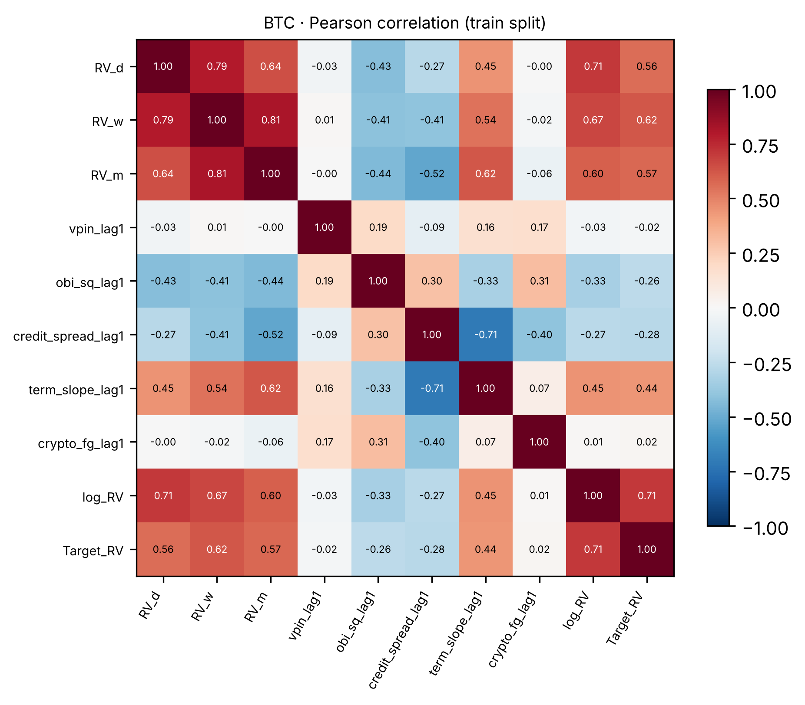 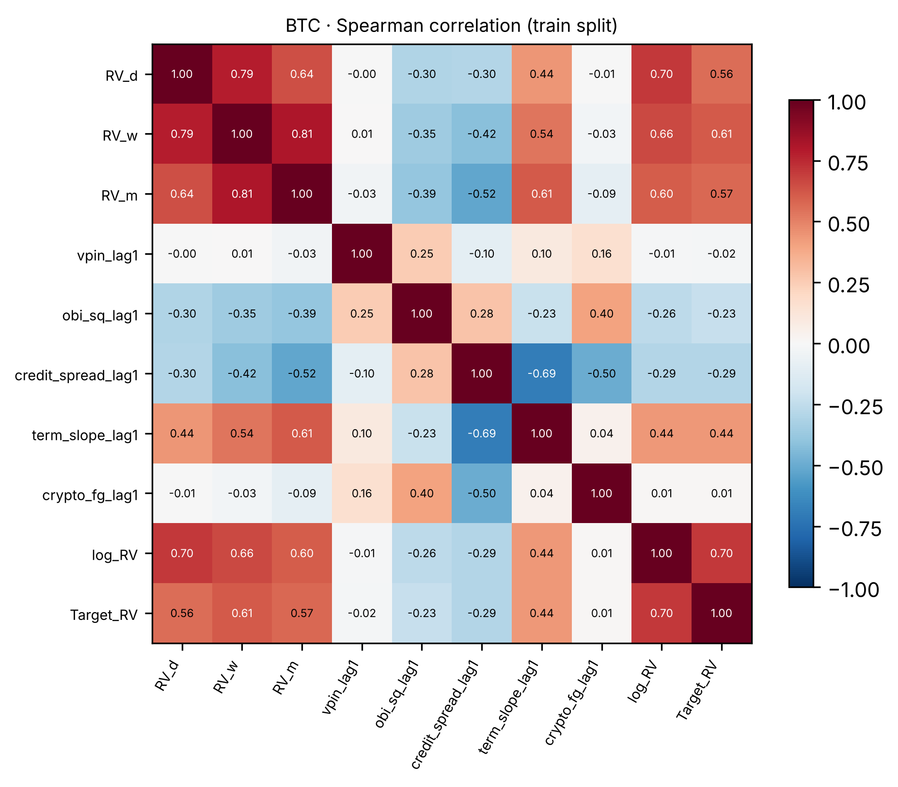

Feature–target association (sorted by mutual information):

| feature | mutual_info | f_stat | f_p | pearson_with_target | spearman_with_target | leakage_flag |
|---|---|---|---|---|---|---|
| RV_w | 0.288 | 1.36e+03 | 2.21e-232 | 0.619 | 0.613 | False |
| RV_m | 0.268 | 1.06e+03 | 1.01e-189 | 0.57 | 0.575 | False |
| RV_d | 0.208 | 998 | 6.66e-181 | 0.559 | 0.559 | False |
| term_slope_lag1 | 0.171 | 540 | 6.25e-107 | 0.444 | 0.436 | False |
| crypto_fg_lag1 | 0.115 | 0.549 | 0.459 | 0.016 | 0.0147 | False |
| credit_spread_lag1 | 0.0875 | 235 | 1.73e-50 | -0.276 | -0.291 | False |
| obi_sq_lag1 | 0.0868 | 157 | 7.1e-35 | -0.259 | -0.231 | False |
| vpin_lag1 | 0.0136 | 0.952 | 0.329 | -0.0208 | -0.0174 | False |

VIF: `{'RV_d': 2.9, 'RV_w': 4.75, 'RV_m': 3.59, 'vpin_lag1': 1.15, 'obi_sq_lag1': 2.56, 'credit_spread_lag1': 2.92, 'term_slope_lag1': 2.25, 'crypto_fg_lag1': 1.2}` (train split; constant features excluded: ['illiq_lag1', 'roll_spread_lag1', 'FinBERT_score_lag1', 'sent_surprise_lag1']).  
Regime vs target: Cramér's V (target terciles) = 0.095, Kruskal–Wallis p = 7.23e-06; train regime counts `{'high': 1920, 'medium': 221, 'low': 54}`.

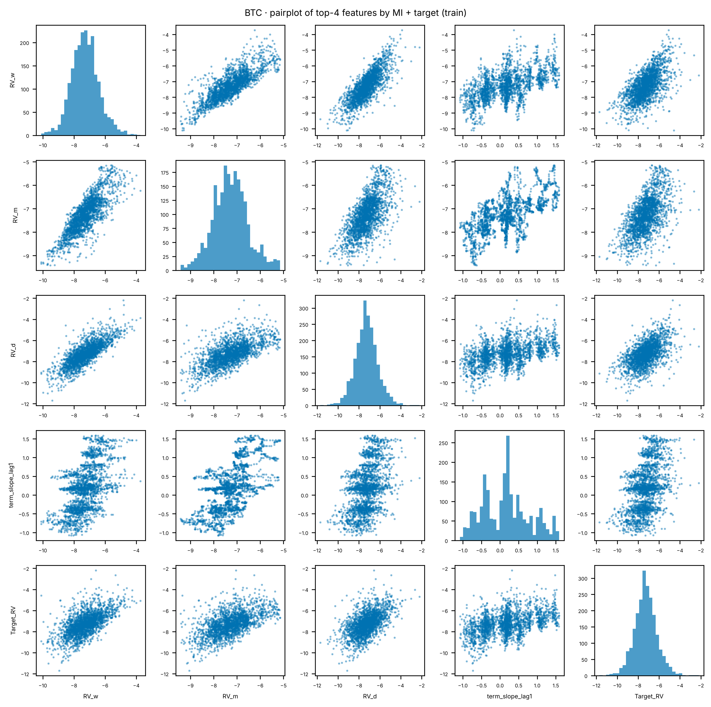

### SPX

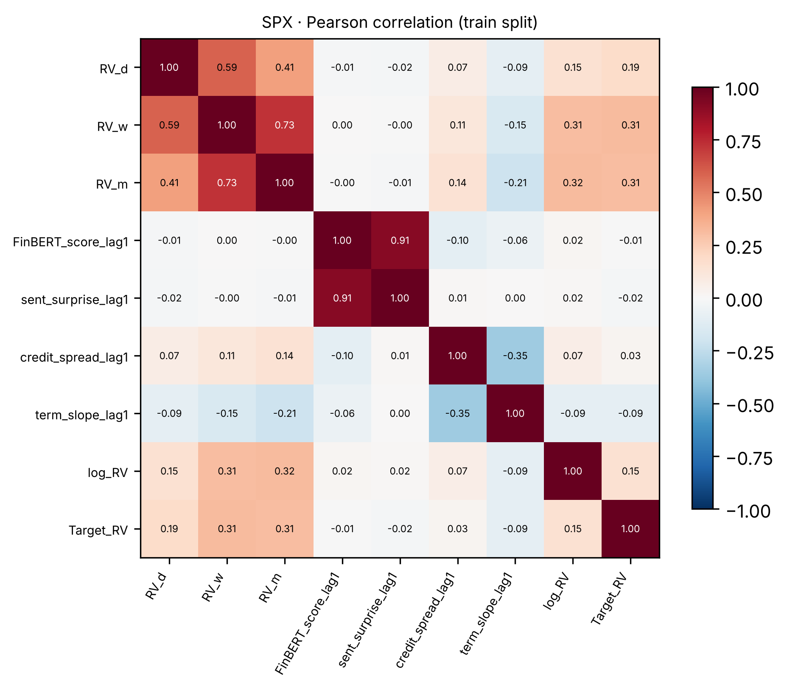 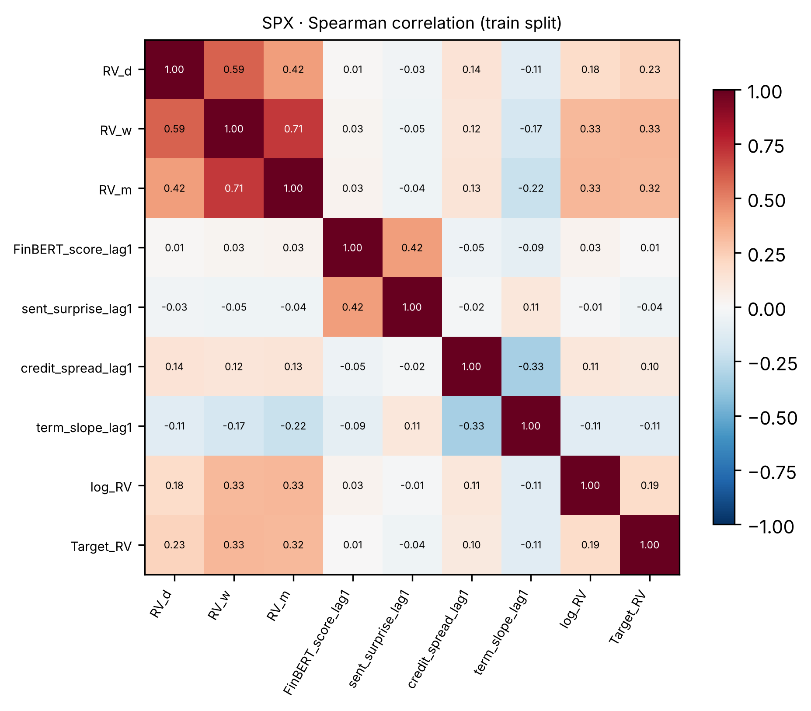

Feature–target association (sorted by mutual information):

| feature | mutual_info | f_stat | f_p | pearson_with_target | spearman_with_target | leakage_flag |
|---|---|---|---|---|---|---|
| RV_w | 0.0987 | 249 | 2.21e-53 | 0.314 | 0.33 | False |
| RV_m | 0.0564 | 246 | 1.13e-52 | 0.311 | 0.322 | False |
| RV_d | 0.0455 | 81.7 | 3.35e-19 | 0.186 | 0.225 | False |
| credit_spread_lag1 | 0.0119 | 1.75 | 0.186 | 0.0276 | 0.0952 | False |
| term_slope_lag1 | 0.00893 | 19.1 | 1.27e-05 | -0.0911 | -0.111 | False |
| sent_surprise_lag1 | 0.00613 | 0.666 | 0.415 | -0.0171 | -0.0449 | False |
| FinBERT_score_lag1 | 0.00427 | 0.111 | 0.739 | -0.00697 | 0.0076 | False |

VIF: `{'RV_d': 1.53, 'RV_w': 2.69, 'RV_m': 2.21, 'FinBERT_score_lag1': 6.01, 'sent_surprise_lag1': 5.97, 'credit_spread_lag1': 1.46, 'term_slope_lag1': 1.55}` (train split; constant features excluded: ['illiq_lag1', 'roll_spread_lag1']).  
Regime vs target: Cramér's V (target terciles) = 0.024, Kruskal–Wallis p = 0.536; train regime counts `{'high': 2269, 'medium': 20}`.

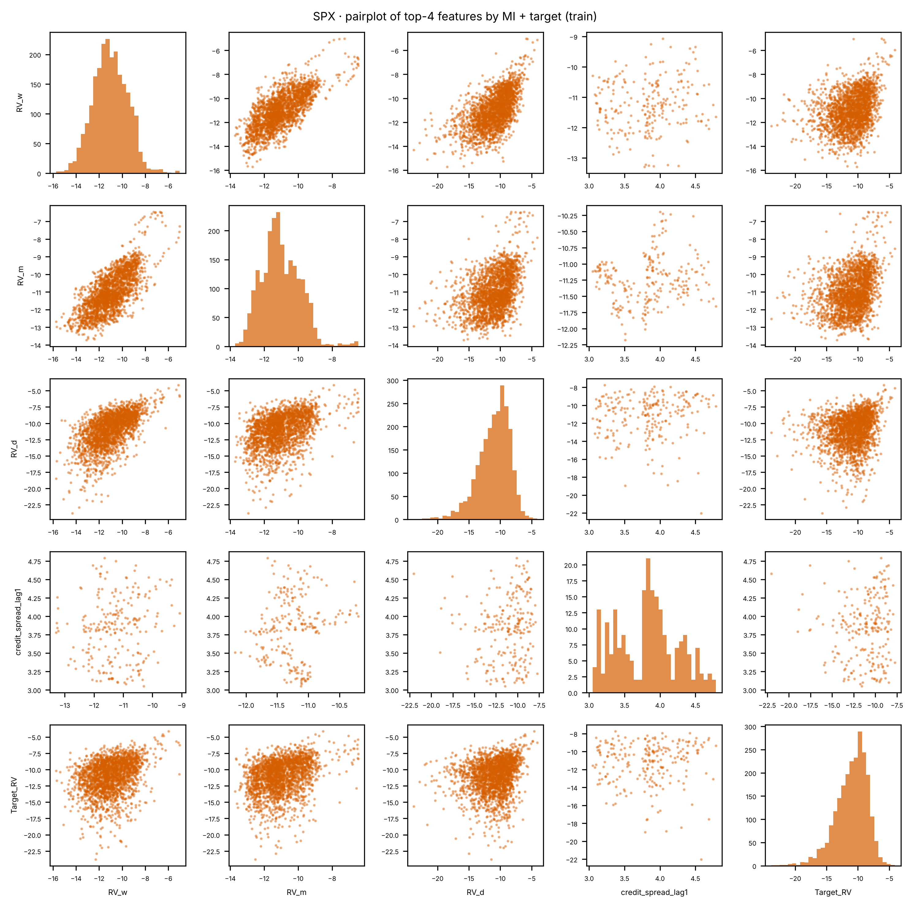

### NIFTY

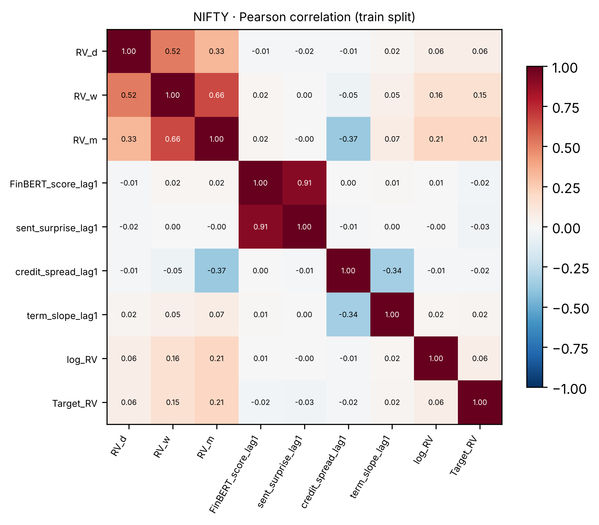 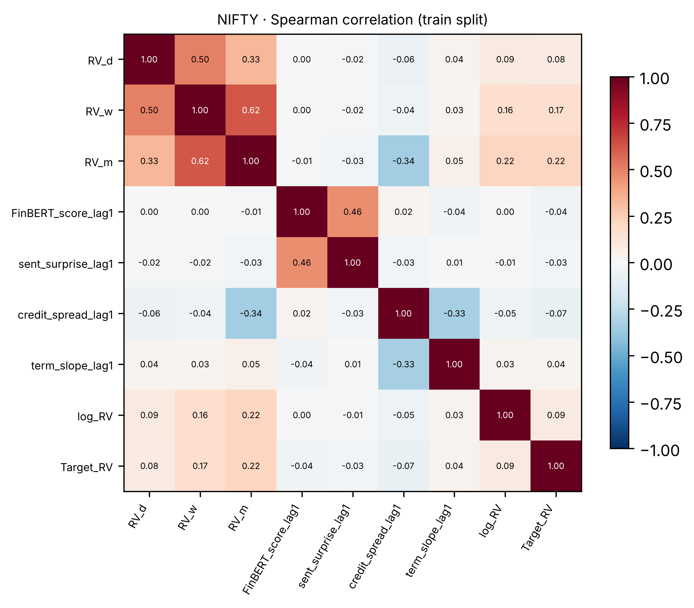

Feature–target association (sorted by mutual information):

| feature | mutual_info | f_stat | f_p | pearson_with_target | spearman_with_target | leakage_flag |
|---|---|---|---|---|---|---|
| RV_w | 0.0655 | 51.7 | 8.79e-13 | 0.151 | 0.165 | False |
| RV_m | 0.0491 | 97.3 | 1.75e-22 | 0.206 | 0.218 | False |
| term_slope_lag1 | 0.0362 | 1.29 | 0.257 | 0.0242 | 0.0355 | False |
| RV_d | 0.026 | 9.27 | 0.00236 | 0.0647 | 0.0824 | False |
| sent_surprise_lag1 | 0.00026 | 2.28 | 0.131 | -0.0322 | -0.0253 | False |
| FinBERT_score_lag1 | 0 | 1.35 | 0.246 | -0.0247 | -0.0352 | False |
| credit_spread_lag1 | 0 | 7.14 | 0.00758 | -0.0209 | -0.0733 | False |

VIF: `{'RV_d': 1.38, 'RV_w': 2.16, 'RV_m': 1.81, 'FinBERT_score_lag1': 6.06, 'sent_surprise_lag1': 6.06, 'credit_spread_lag1': 1.42, 'term_slope_lag1': 1.37}` (train split; constant features excluded: ['illiq_lag1', 'roll_spread_lag1']).  
Regime vs target: Cramér's V (target terciles) = 0.046, Kruskal–Wallis p = 0.915; train regime counts `{'high': 2193, 'medium': 11}`.

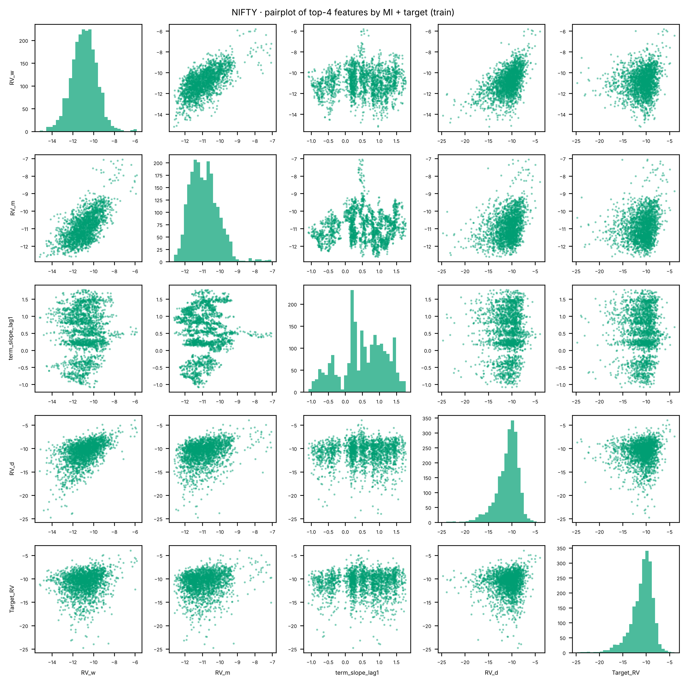

## 7. Integrity and quality (T5, T6)

| Asset | Check | ID | Content hash | Near-dup | Result |
|---|---|---|---|---|---|
| BTC | overlap train-val | 0 | 0 | 0 | PASS |
| BTC | overlap train-test | 0 | 0 | 0 | PASS |
| BTC | overlap val-test | 0 | 0 | 0 | PASS |
| BTC | chronological split order |  |  |  | PASS |
| BTC | Target_RV = next raw trading day | 0 |  |  | PASS |
| BTC | feature-target abs(Spearman) > 0.95 | 0 |  |  | PASS |
| BTC | regime terciles use full sample (look-ahead) |  |  |  | FAIL (data_loader.py:203) |
| SPX | overlap train-val | 0 | 0 | 0 | PASS |
| SPX | overlap train-test | 0 | 0 | 0 | PASS |
| SPX | overlap val-test | 0 | 0 | 0 | PASS |
| SPX | chronological split order |  |  |  | PASS |
| SPX | Target_RV = next raw trading day | 1 |  |  | FAIL |
| SPX | feature-target abs(Spearman) > 0.95 | 0 |  |  | PASS |
| SPX | regime terciles use full sample (look-ahead) |  |  |  | FAIL (data_loader.py:203) |
| NIFTY | overlap train-val | 0 | 0 | 0 | PASS |
| NIFTY | overlap train-test | 0 | 0 | 0 | PASS |
| NIFTY | overlap val-test | 0 | 0 | 0 | PASS |
| NIFTY | chronological split order |  |  |  | PASS |
| NIFTY | Target_RV = next raw trading day | 3 |  |  | FAIL |
| NIFTY | feature-target abs(Spearman) > 0.95 | 0 |  |  | PASS |
| NIFTY | regime terciles use full sample (look-ahead) |  |  |  | FAIL (data_loader.py:203) |

### BTC

- Exact duplicate rows (incl. date): 0; content-only: 0; near-duplicates: 0 (nearest-neighbour distance in standardised model-input space < 1% of median NN distance (0.005837)).
- Split overlap train-val: ID 0, content hash 0, near-dup 0 (0.00% of the later split below the 1st percentile of within-split NN distance).
- Split overlap train-test: ID 0, content hash 0, near-dup 0 (0.00% of the later split below the 1st percentile of within-split NN distance).
- Split overlap val-test: ID 0, content hash 0, near-dup 0 (0.00% of the later split below the 1st percentile of within-split NN distance).
- Temporal: monotonic True, duplicate dates 0, train<val True, val<test True, dates after data pull 0. RV_w/RV_m of the first 22 test rows average log_RV from val dates by construction (not leakage).
- **Target alignment:** 0 of 2744 rows have a Target_RV that is not the next raw trading day's log RV. Examples: `[]`
- Value checks: constant placeholder columns `['illiq_lag1', 'roll_spread_lag1']`; bounds `{'vpin_lag1': {'below_min': 0, 'above_max': 0, 'bounds': [0, 1]}, 'obi_sq_lag1': {'below_min': 0, 'above_max': 0, 'bounds': [0, 1]}, 'crypto_fg_lag1': {'below_min': 0, 'above_max': 0, 'bounds': [0, 1]}, 'FinBERT_score_lag1': {'below_min': 0, 'above_max': 0, 'bounds': [-1, 1]}, 'credit_spread_lag1': {'below_min': 0, 'above_max': 0, 'bounds': [0, None]}}`; log_RV below mean−5sd: 0. credit_spread and term_slope are in percentage points; gmsi = credit_spread - term_slope mixes a spread level with a curve slope (not a standardised index).
- Zero-filled sentiment share by split: `{'FinBERT_score_lag1': {'train': 1.0, 'val': 1.0, 'test': 0.8545454545454545}, 'sent_surprise_lag1': {'train': 1.0, 'val': 1.0, 'test': 0.8545454545454545}}`
- Missingness `FinBERT_score_lag1`: no time dependence detected (first valid 2019-01-24, last valid 2026-07-28, corr with time -0.033).
- Missingness `sent_surprise_lag1`: no time dependence detected (first valid 2019-01-25, last valid 2026-07-28, corr with time -0.047).
- Missingness `credit_spread_lag1`: structural / time-dependent (not MCAR): missing as a contiguous block in time (first valid 2023-05-17, last valid 2026-05-20, corr with time -0.778).
- Missingness `term_slope_lag1`: structural / time-dependent (not MCAR): missing as a contiguous block in time (first valid 2019-01-23, last valid 2026-05-20, corr with time 0.271).
- Missingness `crypto_fg_lag1`: time-dependent (not MCAR) (first valid 2019-01-23, last valid 2026-05-16, corr with time 0.279).
- Missingness `gmsi`: structural / time-dependent (not MCAR): missing as a contiguous block in time (first valid 2023-05-16, last valid 2026-05-19, corr with time -0.777).

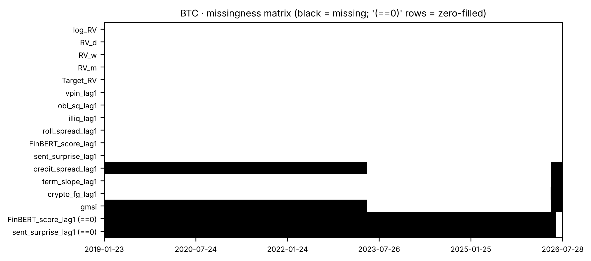

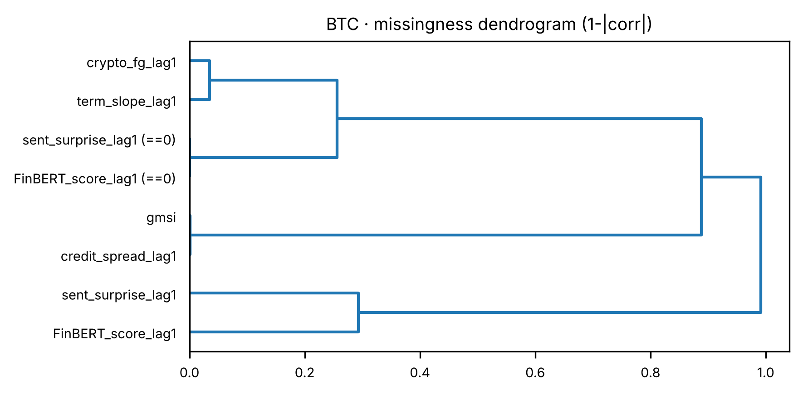

### SPX

- Exact duplicate rows (incl. date): 0; content-only: 0; near-duplicates: 0 (nearest-neighbour distance in standardised model-input space < 1% of median NN distance (0.002938)).
- Split overlap train-val: ID 0, content hash 0, near-dup 0 (0.00% of the later split below the 1st percentile of within-split NN distance).
- Split overlap train-test: ID 0, content hash 0, near-dup 0 (0.00% of the later split below the 1st percentile of within-split NN distance).
- Split overlap val-test: ID 0, content hash 0, near-dup 0 (0.00% of the later split below the 1st percentile of within-split NN distance).
- Temporal: monotonic True, duplicate dates 0, train<val True, val<test True, dates after data pull 0. RV_w/RV_m of the first 22 test rows average log_RV from val dates by construction (not leakage).
- **Target alignment:** 1 of 2862 rows have a Target_RV that is not the next raw trading day's log RV. Examples: `[{'date': '2017-01-09', 'target_is_logRV_of': '2017-02-13', 'next_raw_trading_day': '2017-01-10', 'days_ahead': 35.0}]`
- Calendar gap 2017-01-09 → 2017-02-13 (35 days, 23 raw rows dropped; zero-return day(s) ['2017-01-10']): zero close-to-close return -> log(0)=NaN -> rolling(22) NaN for 22 rows -> rows dropped.
- Value checks: constant placeholder columns `['illiq_lag1', 'roll_spread_lag1']`; bounds `{'FinBERT_score_lag1': {'below_min': 0, 'above_max': 0, 'bounds': [-1, 1]}, 'credit_spread_lag1': {'below_min': 0, 'above_max': 0, 'bounds': [0, None]}}`; log_RV below mean−5sd: 3. credit_spread and term_slope are in percentage points; gmsi = credit_spread - term_slope mixes a spread level with a curve slope (not a standardised index).
- Zero-filled sentiment share by split: `{'FinBERT_score_lag1': {'train': 0.9768457841852337, 'val': 0.951048951048951, 'test': 0.4738675958188153}, 'sent_surprise_lag1': {'train': 0.8785495849716033, 'val': 0.7062937062937062, 'test': 0.23344947735191637}}`
- Missingness `FinBERT_score_lag1`: no time dependence detected (first valid 2015-02-06, last valid 2026-07-28, corr with time -0.032).
- Missingness `sent_surprise_lag1`: no time dependence detected (first valid 2015-02-09, last valid 2026-07-28, corr with time -0.046).
- Missingness `credit_spread_lag1`: structural / time-dependent (not MCAR): missing as a contiguous block in time (first valid 2023-05-17, last valid 2026-05-20, corr with time -0.730).
- Missingness `term_slope_lag1`: structural / time-dependent (not MCAR): missing as a contiguous block in time (first valid 2015-02-05, last valid 2026-05-20, corr with time 0.218).
- Missingness `gmsi`: structural / time-dependent (not MCAR): missing as a contiguous block in time (first valid 2023-05-16, last valid 2026-05-19, corr with time -0.729).

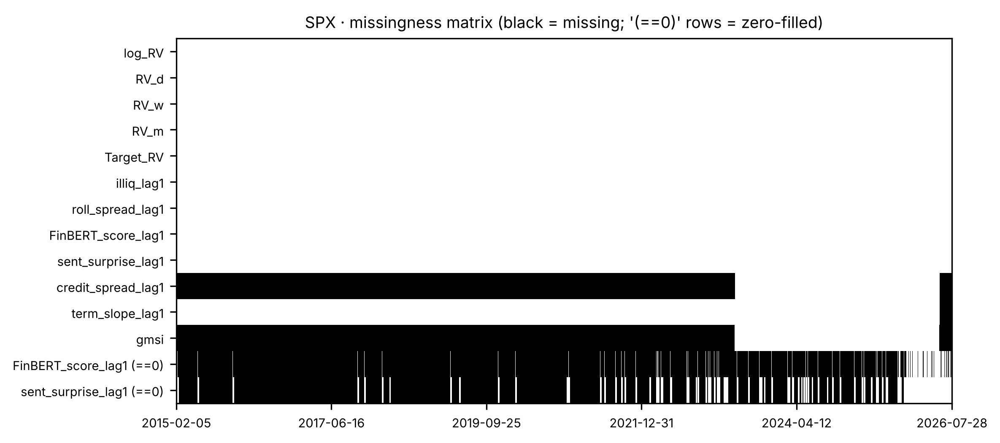

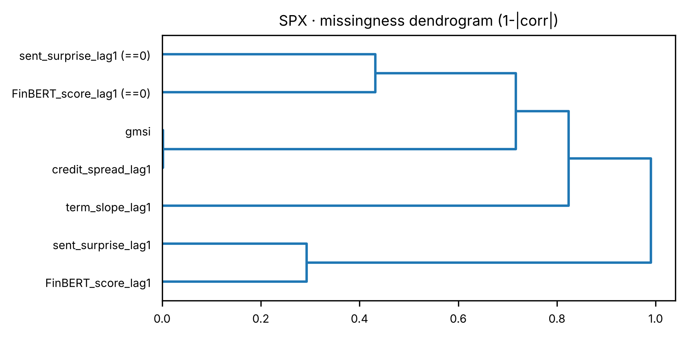

### NIFTY

- Exact duplicate rows (incl. date): 0; content-only: 0; near-duplicates: 0 (nearest-neighbour distance in standardised model-input space < 1% of median NN distance (0.003007)).
- Split overlap train-val: ID 0, content hash 0, near-dup 0 (0.00% of the later split below the 1st percentile of within-split NN distance).
- Split overlap train-test: ID 0, content hash 0, near-dup 0 (0.00% of the later split below the 1st percentile of within-split NN distance).
- Split overlap val-test: ID 0, content hash 0, near-dup 0 (0.00% of the later split below the 1st percentile of within-split NN distance).
- Temporal: monotonic True, duplicate dates 0, train<val True, val<test True, dates after data pull 0. RV_w/RV_m of the first 22 test rows average log_RV from val dates by construction (not leakage).
- **Target alignment:** 3 of 2755 rows have a Target_RV that is not the next raw trading day's log RV. Examples: `[{'date': '2016-10-26', 'target_is_logRV_of': '2016-12-01', 'next_raw_trading_day': '2016-10-27', 'days_ahead': 36.0}, {'date': '2017-03-30', 'target_is_logRV_of': '2017-05-08', 'next_raw_trading_day': '2017-03-31', 'days_ahead': 39.0}, {'date': '2024-05-07', 'target_is_logRV_of': '2024-06-11', 'next_raw_trading_day': '2024-05-08', 'days_ahead': 35.0}]`
- Calendar gap 2016-10-26 → 2016-12-01 (36 days, 23 raw rows dropped; zero-return day(s) ['2016-10-27']): zero close-to-close return -> log(0)=NaN -> rolling(22) NaN for 22 rows -> rows dropped.
- Calendar gap 2017-03-30 → 2017-05-08 (39 days, 23 raw rows dropped; zero-return day(s) ['2017-03-31']): zero close-to-close return -> log(0)=NaN -> rolling(22) NaN for 22 rows -> rows dropped.
- Calendar gap 2024-05-07 → 2024-06-11 (35 days, 23 raw rows dropped; zero-return day(s) ['2024-05-08']): zero close-to-close return -> log(0)=NaN -> rolling(22) NaN for 22 rows -> rows dropped.
- Value checks: constant placeholder columns `['illiq_lag1', 'roll_spread_lag1']`; bounds `{'FinBERT_score_lag1': {'below_min': 0, 'above_max': 0, 'bounds': [-1, 1]}, 'credit_spread_lag1': {'below_min': 0, 'above_max': 0, 'bounds': [0, None]}}`; log_RV below mean−5sd: 5. credit_spread and term_slope are in percentage points; gmsi = credit_spread - term_slope mixes a spread level with a curve slope (not a standardised index).
- Zero-filled sentiment share by split: `{'FinBERT_score_lag1': {'train': 0.9931941923774955, 'val': 0.8909090909090909, 'test': 0.39855072463768115}, 'sent_surprise_lag1': {'train': 0.9677858439201452, 'val': 0.5309090909090909, 'test': 0.2391304347826087}}`
- Missingness `FinBERT_score_lag1`: no time dependence detected (first valid 2015-02-06, last valid 2026-07-28, corr with time -0.033).
- Missingness `sent_surprise_lag1`: no time dependence detected (first valid 2015-02-09, last valid 2026-07-28, corr with time -0.047).
- Missingness `credit_spread_lag1`: structural / time-dependent (not MCAR): missing as a contiguous block in time (first valid 2023-05-17, last valid 2026-05-20, corr with time -0.726).
- Missingness `term_slope_lag1`: structural / time-dependent (not MCAR): missing as a contiguous block in time (first valid 2015-02-05, last valid 2026-05-20, corr with time 0.224).
- Missingness `gmsi`: structural / time-dependent (not MCAR): missing as a contiguous block in time (first valid 2023-05-16, last valid 2026-05-19, corr with time -0.725).

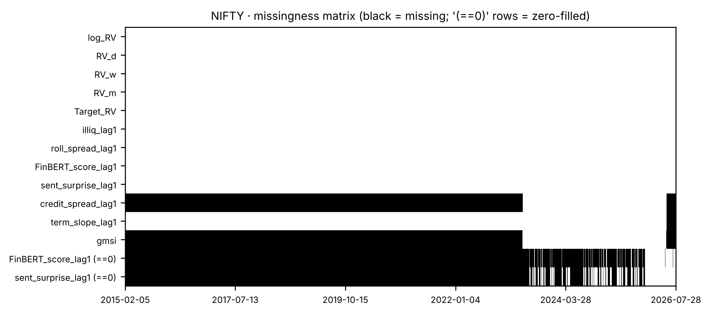

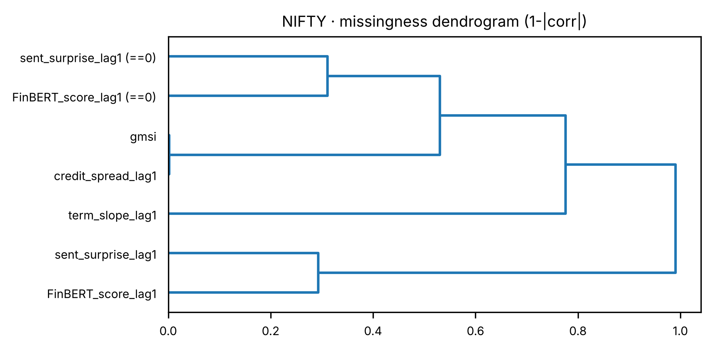

### Distribution drift — train vs test (KS for numerics, χ² for regime)

| asset | feature | test | stat | p | non-iid (p<0.01) |
|---|---|---|---|---|---|
| BTC | RV_d | KS | 0.209 | 7.72e-10 | True |
| BTC | RV_w | KS | 0.285 | 5.36e-18 | True |
| BTC | RV_m | KS | 0.348 | 7.54e-27 | True |
| BTC | vpin_lag1 | KS | 0.125 | 0.000817 | True |
| BTC | obi_sq_lag1 | KS | 0.544 | 8.98e-68 | True |
| BTC | illiq_lag1 | KS | — | — | False |
| BTC | roll_spread_lag1 | KS | — | — | False |
| BTC | FinBERT_score_lag1 | KS | 0.08 | 0.0825 | False |
| BTC | sent_surprise_lag1 | KS | 0.0764 | 0.109 | False |
| BTC | credit_spread_lag1 | KS | 0.564 | 3.41e-46 | True |
| BTC | term_slope_lag1 | KS | 0.702 | 3.73e-92 | True |
| BTC | crypto_fg_lag1 | KS | 0.559 | 1.12e-54 | True |
| BTC | Target_RV | KS | 0.209 | 7.72e-10 | True |
| BTC | regime | chi2 | 1.72e+03 | 0 | True |
| SPX | RV_d | KS | 0.0924 | 0.0239 | False |
| SPX | RV_w | KS | 0.136 | 0.000137 | True |
| SPX | RV_m | KS | 0.242 | 1.16e-13 | True |
| SPX | illiq_lag1 | KS | — | — | False |
| SPX | roll_spread_lag1 | KS | — | — | False |
| SPX | FinBERT_score_lag1 | KS | 0.281 | 2.88e-18 | True |
| SPX | sent_surprise_lag1 | KS | 0.366 | 4.63e-31 | True |
| SPX | credit_spread_lag1 | KS | 0.879 | 3.68e-95 | True |
| SPX | term_slope_lag1 | KS | 0.436 | 5.12e-38 | True |
| SPX | Target_RV | KS | 0.0894 | 0.0318 | False |
| SPX | regime | chi2 | 2.44e+03 | 0 | True |
| NIFTY | RV_d | KS | 0.0954 | 0.0214 | False |
| NIFTY | RV_w | KS | 0.152 | 1.93e-05 | True |
| NIFTY | RV_m | KS | 0.211 | 5.11e-10 | True |
| NIFTY | illiq_lag1 | KS | — | — | False |
| NIFTY | roll_spread_lag1 | KS | — | — | False |
| NIFTY | FinBERT_score_lag1 | KS | 0.372 | 6.53e-31 | True |
| NIFTY | sent_surprise_lag1 | KS | 0.376 | 1.56e-31 | True |
| NIFTY | credit_spread_lag1 | KS | 0.918 | 6.06e-101 | True |
| NIFTY | term_slope_lag1 | KS | 0.436 | 2.82e-36 | True |
| NIFTY | Target_RV | KS | 0.0954 | 0.0214 | False |
| NIFTY | regime | chi2 | 2.4e+03 | 0 | True |

Train-vs-val and val-vs-test drift tests: `data_profile.json → integrity.drift_*`.

## 8. Figures index

**BTC:** target by split 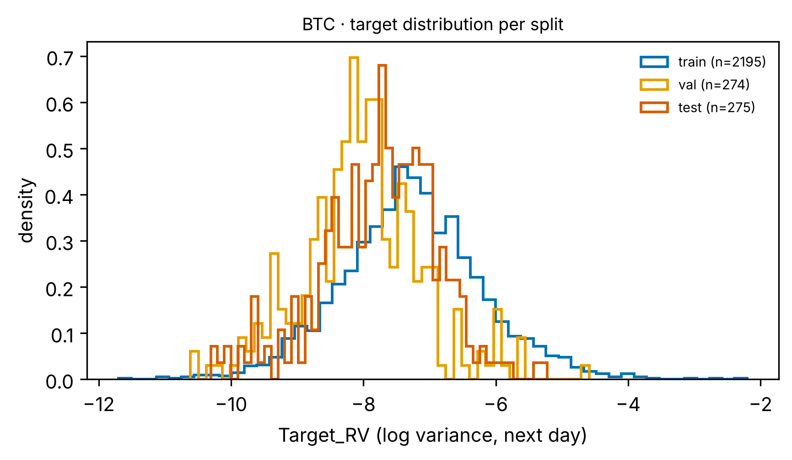 drift 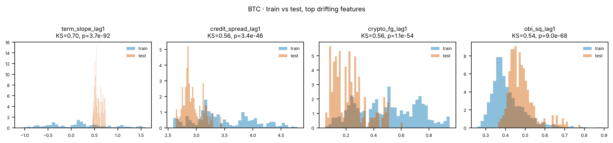 PCA/t-SNE 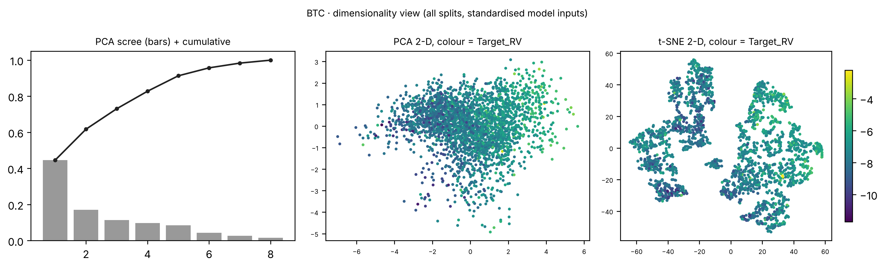 regime 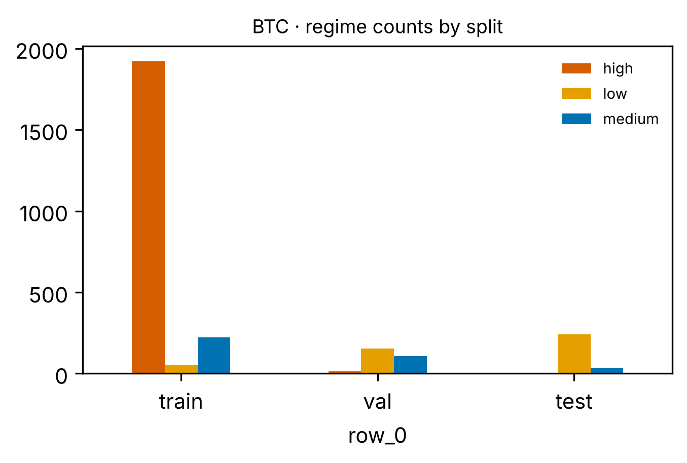

Per-feature histogram+KDE / box / violin: [num_btc_log_RV](figures/profile/num_btc_log_RV.png), [num_btc_RV_d](figures/profile/num_btc_RV_d.png), [num_btc_RV_w](figures/profile/num_btc_RV_w.png), [num_btc_RV_m](figures/profile/num_btc_RV_m.png), [num_btc_Target_RV](figures/profile/num_btc_Target_RV.png), [num_btc_vpin_lag1](figures/profile/num_btc_vpin_lag1.png), [num_btc_obi_sq_lag1](figures/profile/num_btc_obi_sq_lag1.png), [num_btc_illiq_lag1](figures/profile/num_btc_illiq_lag1.png), [num_btc_roll_spread_lag1](figures/profile/num_btc_roll_spread_lag1.png), [num_btc_FinBERT_score_lag1](figures/profile/num_btc_FinBERT_score_lag1.png), [num_btc_sent_surprise_lag1](figures/profile/num_btc_sent_surprise_lag1.png), [num_btc_credit_spread_lag1](figures/profile/num_btc_credit_spread_lag1.png), [num_btc_term_slope_lag1](figures/profile/num_btc_term_slope_lag1.png), [num_btc_crypto_fg_lag1](figures/profile/num_btc_crypto_fg_lag1.png), [num_btc_gmsi](figures/profile/num_btc_gmsi.png)

**SPX:** target by split 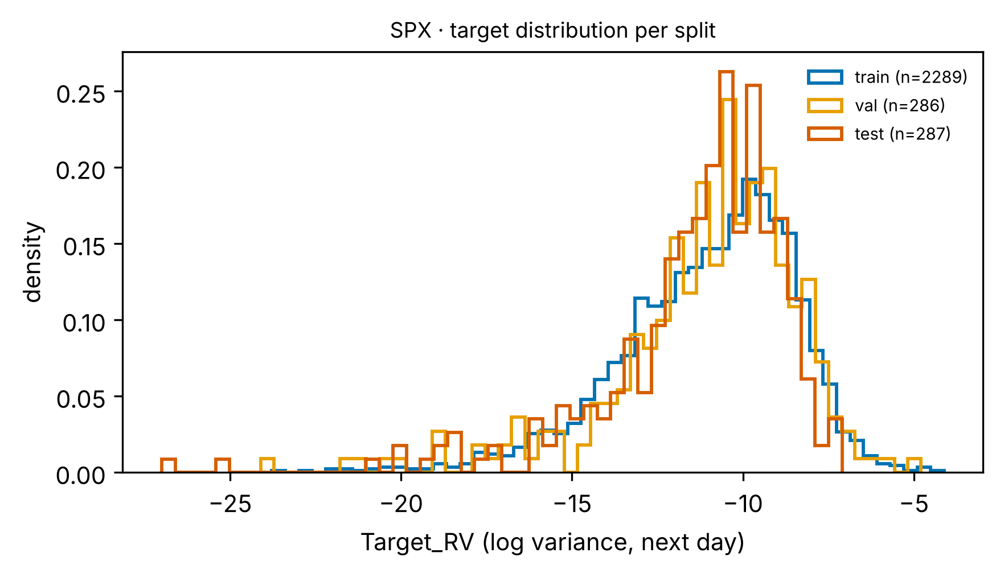 drift 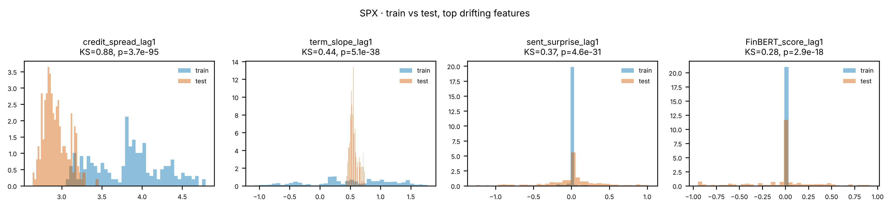 PCA/t-SNE 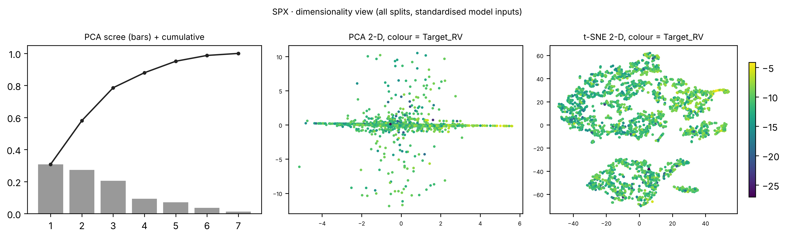 regime 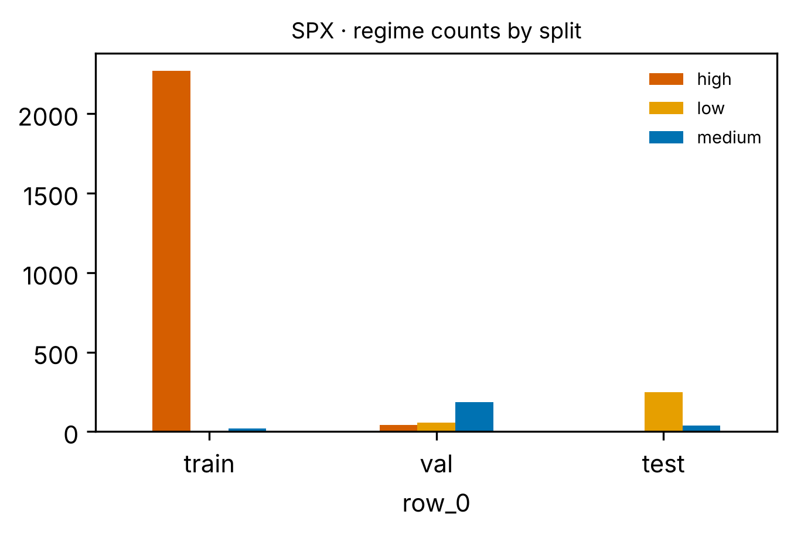

Per-feature histogram+KDE / box / violin: [num_spx_log_RV](figures/profile/num_spx_log_RV.png), [num_spx_RV_d](figures/profile/num_spx_RV_d.png), [num_spx_RV_w](figures/profile/num_spx_RV_w.png), [num_spx_RV_m](figures/profile/num_spx_RV_m.png), [num_spx_Target_RV](figures/profile/num_spx_Target_RV.png), [num_spx_illiq_lag1](figures/profile/num_spx_illiq_lag1.png), [num_spx_roll_spread_lag1](figures/profile/num_spx_roll_spread_lag1.png), [num_spx_FinBERT_score_lag1](figures/profile/num_spx_FinBERT_score_lag1.png), [num_spx_sent_surprise_lag1](figures/profile/num_spx_sent_surprise_lag1.png), [num_spx_credit_spread_lag1](figures/profile/num_spx_credit_spread_lag1.png), [num_spx_term_slope_lag1](figures/profile/num_spx_term_slope_lag1.png), [num_spx_gmsi](figures/profile/num_spx_gmsi.png)

**NIFTY:** target by split 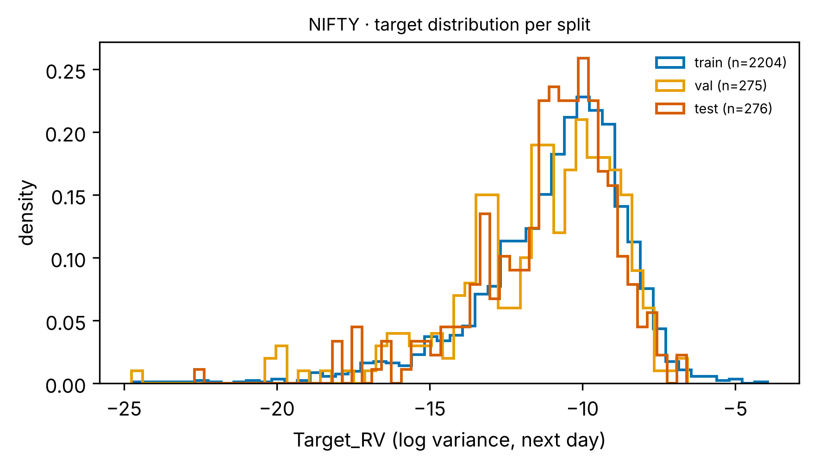 drift 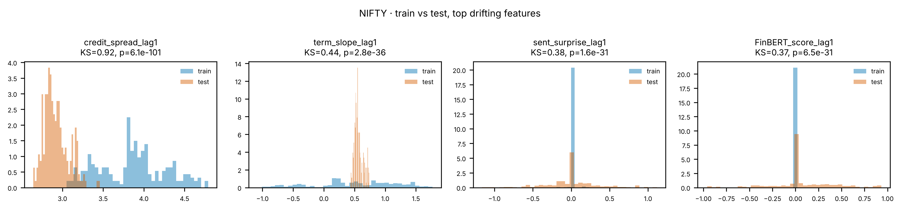 PCA/t-SNE 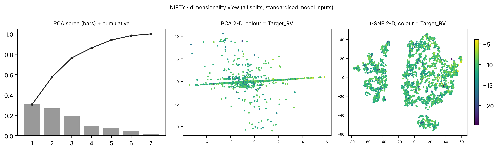 regime 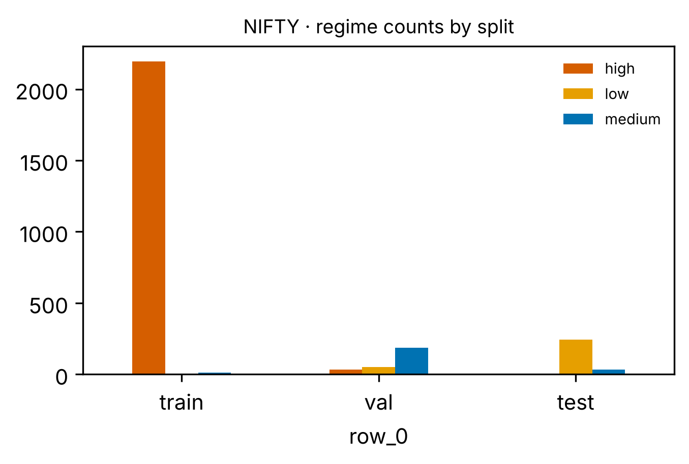

Per-feature histogram+KDE / box / violin: [num_nifty_log_RV](figures/profile/num_nifty_log_RV.png), [num_nifty_RV_d](figures/profile/num_nifty_RV_d.png), [num_nifty_RV_w](figures/profile/num_nifty_RV_w.png), [num_nifty_RV_m](figures/profile/num_nifty_RV_m.png), [num_nifty_Target_RV](figures/profile/num_nifty_Target_RV.png), [num_nifty_illiq_lag1](figures/profile/num_nifty_illiq_lag1.png), [num_nifty_roll_spread_lag1](figures/profile/num_nifty_roll_spread_lag1.png), [num_nifty_FinBERT_score_lag1](figures/profile/num_nifty_FinBERT_score_lag1.png), [num_nifty_sent_surprise_lag1](figures/profile/num_nifty_sent_surprise_lag1.png), [num_nifty_credit_spread_lag1](figures/profile/num_nifty_credit_spread_lag1.png), [num_nifty_term_slope_lag1](figures/profile/num_nifty_term_slope_lag1.png), [num_nifty_gmsi](figures/profile/num_nifty_gmsi.png)

## 9. PCA

- BTC: 8 standardised inputs; cumulative variance of first 3 PCs = 0.446, 0.617, 0.731.
- SPX: 7 standardised inputs; cumulative variance of first 3 PCs = 0.308, 0.581, 0.786.
- NIFTY: 7 standardised inputs; cumulative variance of first 3 PCs = 0.306, 0.573, 0.764.

## 10. Provenance, interpretation, and what the data can support

*Hand-written. Every number cites `analysis/artifacts/data_profile.json` (`scripts/profile_data.py`) unless another script is named. This file is spliced into `01_data_profile.md` when the profiler runs.*

### 10.1 Provenance and licensing

| Source | Used for | Collection | Period in repo | Licence / terms | Known biases / caveats |
|---|---|---|---|---|---|
| Binance REST klines (`/api/v3/klines`), BTC/USDT | BTC 5-min RV, OBI/VPIN proxies, BTC returns | `fetch_binance.py` | 2019-01-01 → 2026-07-29 (795,988 5-min rows) | Binance API terms. Exchange data, not a consolidated price. | Single venue (USDT pair), not a cross-exchange index. 24/7 market. Weekend effects visible as 7-day ACF peaks (`target_quality.md`). |
| Yahoo Finance via `yfinance` (`^GSPC`, `^NSEI`) | SPX/NIFTY returns, daily OHLC | `fetch_yfinance.py` | 2015-01-02 → 2026-07-29 | The yfinance README states the Yahoo API is "intended for personal use only" ([yfinance](https://github.com/ranaroussi/yfinance)). **Redistributing the raw OHLC in a public repo may breach Yahoo's terms. Check before publishing.** | Index OHLC from a free aggregator. NIFTY has 29 zero-volume days (`target_quality.json → ohlc_quality`). |
| FRED (St. Louis Fed) | `term_slope` (T10Y2Y), `credit_spread` (BAMLH0A0HYM2) | `fetch_fred.py` | 2015-01 → **2026-05-14** | Public domain except third-party series. ICE BofA series are copyrighted by ICE, and FRED serves only a **rolling 3-year window** ([secondary source](https://eco3min.fr/credit-spreads-recession-risk-dataset/)). | Both ICE BofA series start **2023-05-16**, while all 17 other FRED series start in 2015 (`fred_first_valid`). This is exactly a 3-year window before the pull, so the credit-spread gap is **vendor policy, not a bug**. The pull ends 2026-05-14, so macro is missing at the end of the test window. |
| Alternative.me Crypto Fear & Greed | `crypto_fg` (BTC) | `fetch_fear_greed.py` | ends 2026-05-16 (last valid in matrix) | Free; attribution required next to any display of the data ([alternative.me](https://alternative.me/crypto/fear-and-greed-index/)). **The paper and dashboard must credit it.** | Proprietary composite; methodology not peer-reviewed. |
| Alpha Vantage NEWS_SENTIMENT (+ Finnhub) | FinBERT text | `fetch_news_extended.py` | see `sentiment_coverage_diagnosis.md` | Vendor terms (not verified: alphavantage.co blocked from the audit container). | Count-capped "latest 1,000" pull; NIFTY = HDFC Bank ADR news; templated robo-headlines ("HDFC Bank falls Monday, underperforms market"). |
| `ProsusAI/finbert` (Araci 2019) | sentiment scoring | `sentiment_engine.py` | — | **Licence NOT VERIFIED** (huggingface.co blocked). | Trained on Financial PhraseBank (English financial news sentences). Label order assumed, not verified. |

### 10.2 Key quantitative facts

1. **Splits are chronological and clean.** 0 ID overlaps, 0 content-hash overlaps and 0 near-duplicates across every split pair for every asset. Train < val < test strictly. No future dates. No duplicate dates. Leakage in the "row overlap" sense is **absent** (T6).
2. **But the data is not i.i.d. across splits, by a wide margin.** Train-vs-test KS tests reject at p < 0.01 for every exogenous feature that varies, except BTC FinBERT, which is identically zero in train. Examples: credit spread KS = 0.564 / 0.879 / 0.918 (BTC/SPX/NIFTY); term slope 0.702 / 0.436 / 0.436; BTC OBI² 0.544. Regime χ² p ≈ 0 for all assets.
3. **The target itself drifts for BTC only.** BTC test mean log variance −7.752 vs train −7.274 (KS 0.209, p = 7.7e−10). SPX (KS 0.089, p = 0.032) and NIFTY (KS 0.095, p = 0.021) do not reject at 1 %. This also settles `paper_vs_code.md` E4: the test window is calmer than train **for BTC** (significant); for SPX/NIFTY the difference is not significant at 1 %.
4. **The model-input space is dominated by a data-availability break, not by market state.** In the 2-D t-SNE of standardized model inputs, a 2-cluster k-means split separates rows almost perfectly by whether `credit_spread` exists: BTC clusters contain 0 / 1,100 credit-available rows, SPX 0 / 755, NIFTY 717 / 2 (`data_profile.json → tsne_cluster_vs_credit_available`). With Neural-HAR's 0-fill, this becomes a pre/post-mid-2023 indicator that a network can exploit.
5. **The regime label is almost a split indicator.** Train regimes: BTC high 1,920 / medium 221 / low 54; SPX high 2,269 / medium 20 / low 0; NIFTY high 2,193 / medium 11 / low 0. Test regimes: BTC low 240 / medium 35; SPX low 249 / medium 38; NIFTY low 243 / medium 33. For SPX/NIFTY the regime has no association with the target in train (Kruskal–Wallis p = 0.536 / 0.915; Cramér's V 0.024 / 0.046). Regime labels are also **not reproducible at bin edges**: 4 NIFTY rows lying exactly on a tercile edge (gmsi = 3.58, 2.58) change label between the committed file and a rebuild.
6. **Sentiment is disguised-missing.** Share of rows with FinBERT == 0 by train / val / test: BTC 100 % / 100 % / 85.5 %; SPX 97.7 % / 95.1 % / 47.4 %; NIFTY 99.3 % / 89.1 % / 39.9 %. Sentiment availability therefore *is* a test-period indicator. FinBERT and sentiment-surprise are collinear (VIF 6.01 / 5.97 SPX, 6.06 / 6.06 NIFTY). 93.9 % of headlines (2,280 / 2,428) map to test rows. Test-vs-train vocabulary OOV is 54.8 % (SPX) and 55.6 % (NIFTY); BTC has no train headlines.
7. **Two all-zero placeholder columns** (`illiq_lag1`, `roll_spread_lag1`) are model inputs for every asset.
8. **Target misalignment bug confirmed.** 1 SPX row and 3 NIFTY rows have a `Target_RV` that is 35–39 calendar days ahead instead of the next trading day (T6). Each is caused by a single zero close-to-close return: log(0) = NaN, an unpadded `rolling(22)` produces 22 NaN rows, 23 raw rows are dropped, and the target shift is applied after the drop. BTC: 0.
9. **Macro features vanish at the end of the test window.** `credit_spread_lag1` is NaN for 25.1 % (BTC), 16.0 % (SPX) and 17.0 % (NIFTY) of test rows, because the FRED pull ends 2026-05-14 and `align_macro` nulls values more than 5 days stale. HAR-S fills these test NaNs with the training mean. Neural-HAR forward-fills a constant.
10. **What a meaningful score is (the analogue of a majority-class baseline).** On the exact test windows used in the paper, the constant *train-mean* forecast scores QLIKE 0.360 / 2.750 / 2.665 and MSE 0.997 / 7.590 / 5.230 (BTC/SPX/NIFTY). Phase 1 measured the paper's HAR on the same windows at QLIKE 0.318 / **3.897** / 2.330: **on SPX, HAR is worse than a constant forecast.** For BTC, the random walk on log RV_t (today's value, which HAR does not use) gives R²_OOS = 0.311 against the train mean; the as-coded lag RV_{t−1} gives −0.091.
11. **The log transform is appropriate.** Box–Cox λ on raw variance: −0.035 (BTC), 0.116 (SPX), 0.139 (NIFTY). Skewness falls from 20.7 / 17.2 / 25.7 on the raw scale to 0.147 / −1.082 / −1.299 in logs. The left skew for SPX/NIFTY is the log-χ² tail of squared returns (`target_quality.md`).
12. **Multicollinearity among the HAR lags is mild** (VIF ≤ 4.75), and no feature has |Spearman| > 0.95 with the target, so there is no direct target leakage through features. The strongest association with the target is the HAR weekly lag (MI 0.288 BTC / 0.099 SPX / 0.066 NIFTY). Every sentiment feature has MI ≤ 0.006.

### 10.3 What this data **can** support as a claim

* **BTC:** a forecasting comparison of HAR-family vs ML models on a clean, non-overlapping chronological split of 5-min RV. Note that the test window is significantly calmer than train, so results are window-specific.
* **All assets:** statements about **macro / microstructure-proxy features available from mid-2023** (credit spread), on the ~3-year window where they exist.
* **SPX/NIFTY:** statements about forecasting **squared daily returns**, which is a weak target (≤ 9.5 % linear R² ceiling). Or, after switching to the GK column already in the files, statements about daily-range variance (ceiling 51 % / 36 %).
* Descriptive statements: e.g., log RV persistence and weekly seasonality in BTC.

### 10.4 What this data **cannot** support

* **Any claim that news sentiment adds (or does not add) forecasting information.** Sentiment is absent from BTC training data entirely and present on ≤ 2.3 % of SPX/NIFTY training rows. Its availability is confounded with the test period.
* **Any regime-dependence claim.** The regime is a pre/post-2024 indicator and is unrelated to the target for SPX/NIFTY.
* **"Microstructure" claims for SPX/NIFTY** (no microstructure features exist) and **order-book claims for BTC** (kline proxies only).
* **Cross-asset comparisons of forecast accuracy levels.** BTC uses intraday RV, while SPX/NIFTY use squared daily returns, so their losses are on incomparable scales and noise levels.
* **Generalization across market states.** The ~1-year test windows (2025-06 → 2026-07 for SPX/NIFTY, 2025-10 → 2026-07 for BTC) contain no crisis and, for BTC, are calmer than training.
