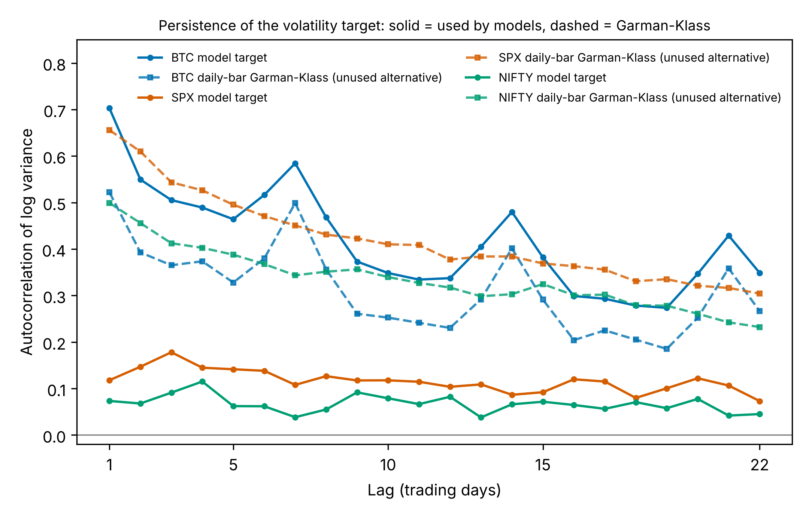

# Target quality: how forecastable is each volatility series?

**Script:** `scripts/target_quality.py` (deterministic) → `analysis/artifacts/target_quality.json`, `analysis/tables/T_target_quality.{csv,tex}`, `analysis/tables/T_acf_lags.{csv,tex}`, `analysis/figures/target_acf.{png,svg}`.
**Status:** document and recommend only. The volatility measure has **not** been changed.

## 1. The SPX/NIFTY target is not what the paper or the code says it is (BLOCKER)

`compute_rv.py:compute_tradfi_rv` and its docstring say Garman–Klass is the primary RV proxy, and `03_data.tex` says "a realized volatility proxy is constructed from daily OHLCV". The **committed** files tell a different story:

| Asset | `max |log_RV − log(RV)|` | `max |RV − log_ret²|` | `max |log_RV − log(GK)|` |
|---|---|---|---|
| SPX | 0.0 | **0.0** | 17.92 |
| NIFTY | 0.0 | **0.0** | 15.59 |
| BTC | 0.0 | — (RV = Σ 5-min r²) | 1.49 |

For SPX and NIFTY the models forecast **log of the squared daily close-to-close return**, the noisiest variance proxy in common use. The committed `spx_rv_daily.parquet`/`nifty_rv_daily.parquet` have columns `PK, GK, log_ret, RV, log_RV, …`. The current `compute_tradfi_rv` would write `rv, GK, PK, RV_cc, log_ret`. **The committed RV files were therefore produced by a different, uncommitted version of the code.** Re-running `compute_rv.py` today would silently change the SPX/NIFTY target to GK and change every SPX/NIFTY number in the paper.

This also explains several earlier anomalies:
* Minimum log_RV of −27.0 (SPX) and −24.75 (NIFTY): days with a near-zero close-to-close return give log r² → −∞. 1.26 % (SPX) and 1.20 % (NIFTY) of targets lie more than 3 sd below the mean.
* QLIKE values about 10× BTC's, and the large smearing correction found in Phase 1 (1.77 log units for SPX). E[log ε²] = −1.27 for Gaussian ε, so exp(E[log r²]) under-states variance by a factor of ≈ 3.6, and a model trained on QLIKE learns to undo exactly that.

## 2. Persistence, Ljung–Box and predictability ceilings

| Series | N | AC(1) | AC(5) | AC(22) | LB(22) Q (p) | Signal share λ | YW R² ceiling, 1-step | YW R² ceiling, as coded | OLS R²: HAR as coded | OLS R²: HAR 1-step | OLS R²: AR(22) |
|---|---|---|---|---|---|---|---|---|---|---|---|
| **BTC target** (5-min RV) | 2,744 | 0.703 | 0.464 | 0.349 | 11,328.9 (≈0) | 0.600 | 0.617 | 0.516 | 0.402 | **0.535** | 0.619 |
| BTC daily-bar GK (control) | 2,767 | 0.522 | 0.328 | 0.266 | 6,480.8 (≈0) | 0.441 | 0.438 | 0.381 | 0.274 | 0.349 | 0.442 |
| **SPX target** (log r²) | 2,862 | 0.118 | 0.141 | 0.073 | 890.4 (3.8e−174) | 0.150 | 0.095 | 0.095 | 0.090 | 0.090 | 0.096 |
| SPX daily-bar GK (unused) | 2,909 | 0.656 | 0.495 | 0.304 | 11,951.7 (≈0) | 0.612 | 0.514 | 0.448 | 0.444 | **0.505** | 0.515 |
| **NIFTY target** (log r²) | 2,755 | 0.073 | 0.062 | 0.045 | 293.3 (2.7e−49) | 0.081 | 0.048 | 0.047 | 0.041 | 0.042 | 0.048 |
| NIFTY daily-bar GK (unused) | 2,848 | 0.499 | 0.388 | 0.232 | 7,346.2 (≈0) | 0.464 | 0.363 | 0.322 | 0.316 | **0.356** | 0.364 |

GK rows use all rows of the raw RV file (their own calendar), so N differs from the model target. Full lag-1…22 ACF: `analysis/tables/T_acf_lags.csv`. Parkinson (PK) behaves like GK; see the JSON.

**How to read the ceilings.**
* *Yule–Walker (YW) ceiling* = r′R⁻¹r computed from the sample ACF. It is the population R² of the best **linear** predictor using 22 past values. "1-step" uses {y_t…y_{t−21}}; "as coded" uses {y_{t−1}…y_{t−22}}, the information set the HAR implementation actually has (it skips day t; see `00_repo_map.md` §5).
* *Signal share λ* comes from fitting ρ_obs(k) = λφ^k over k = 1…22, i.e. modelling the observation as AR(1)-signal plus white measurement noise. λ = Var(signal)/Var(observed) caps the R² of **any** forecaster, linear or not, against this noisy target. The fit gives φ ≈ 0.97–0.98 for every series.
* *Independent check for log r²:* Var(log ε²) = π²/2 for Gaussian ε, so 1 − (π²/2)/Var(y) is an upper bound on the predictable share. It gives **0.265 (SPX)** and **0.171 (NIFTY)**; fat-tailed ε lowers these further. Both bounds agree that ≥ 73 % (SPX) and ≥ 83 % (NIFTY) of the target's variance is unforecastable noise.

## 3. What this means for the paper

1. **The SPX/NIFTY experiments are run against a target that is ~85–92 % noise.** The best possible linear R² is 0.095 (SPX) and 0.048 (NIFTY), and plain HAR already reaches 0.090 / 0.041. There is almost no room for any model, sentiment-augmented or neural, to improve the *conditional mean*. What remains to gain is mostly **level calibration** (the log-χ² bias), which is exactly what a QLIKE-trained Neural-HAR learns. This matches the Phase-1 smearing result and the "wins on QLIKE, loses on MSE" pattern.
2. **Ljung–Box rejects white noise for all series** (smallest Q = 293.3 at lag 22, p = 2.7e−49). The SPX/NIFTY targets are statistically persistent, but economically their persistence is small.
3. **The 2-step lag bug costs BTC 13 R² points.** In-sample HAR R² is 0.402 as coded vs 0.535 correctly specified. It costs SPX/NIFTY almost nothing only because there is nothing to lose.
4. **BTC shows clear 7-day seasonality** (ACF peaks at lags 7, 14, 21). The HAR "weekly" component is a 5-observation window, which on a 7-day calendar is not a week. This is a specification choice a referee will notice.
5. **BTC's own daily-bar GK is a useful control.** On the same asset, moving from 5-min RV to one daily bar drops AC(1) from 0.703 to 0.522 and HAR 1-step R² from 0.535 to 0.349. So even GK for SPX/NIFTY is not equivalent to intraday RV, and cross-asset comparisons with BTC are apples-to-oranges unless the measures are harmonized.

## 4. Recommendations (for decision; nothing changed)

| Option | Effort | Effect (from the table above) | Caveat |
|---|---|---|---|
| **R1. Use the GK column already in the committed files** for SPX/NIFTY targets and lags | Very low: a config change in the loader, no new data | Raises the 1-step HAR R² ceiling from 0.095 → 0.514 (SPX) and 0.048 → 0.363 (NIFTY) | Still a daily-bar proxy. GK ignores overnight returns for indices (open ≠ previous close), so overnight variance is missing. Document it. |
| **R2. Intraday RV for SPX/NIFTY** (5-min bars from a data vendor, or SPY/ES and NIFTY futures) | High: needs data access | Harmonizes with BTC; the standard in the HAR literature | Cost and licensing. The Oxford-Man Realized Library (formerly the standard free source) is no longer updated. |
| **R3. Keep squared returns but say so**, and evaluate with QLIKE, which is robust to proxy noise (Patton 2011) | None | Honest | Severely limits what can be learned. A referee will ask for R1/R2. |
| **R4. Regardless of target:** fix the 2-step lag (use log RV_t in RV_d), make the bias correction part of the HAR baseline, and for BTC consider a 7-day weekly window | Low | +13 R² points for BTC in-sample | Changes every reported number, so do it once, with all fixes, before Phase 5. |

**My recommendation: R1 + R4 now (R1 needs only data already in the repo), and R2 as stated future work or a robustness section.** The paper text must also be corrected to describe whichever estimator is used. Today it describes GK while the code uses squared returns.
